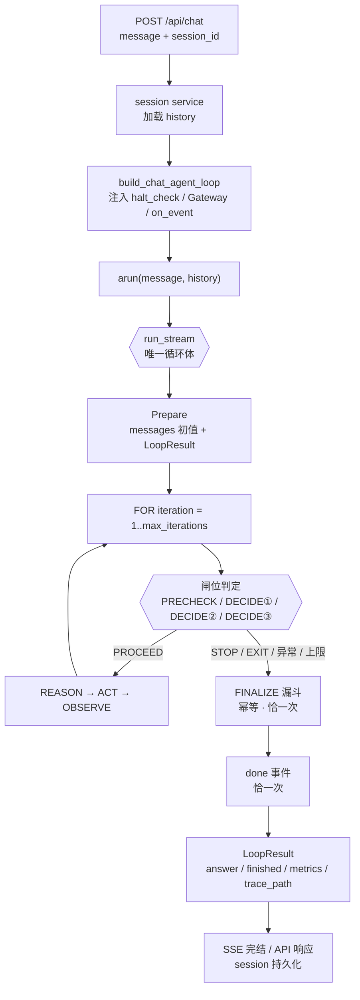
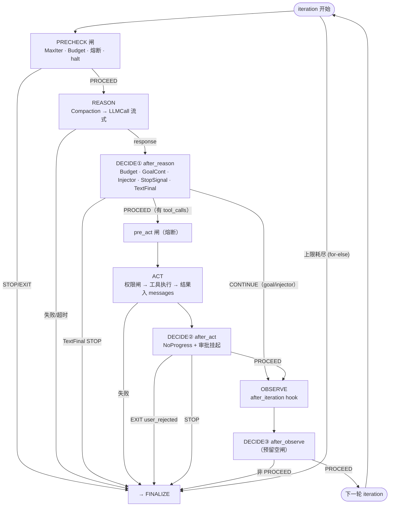
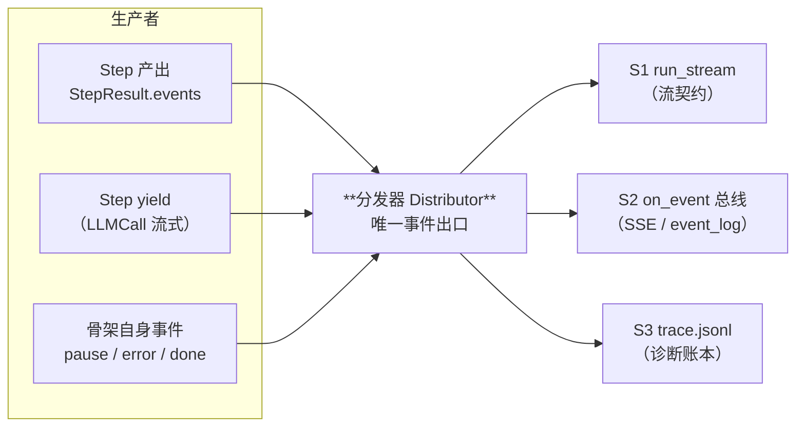
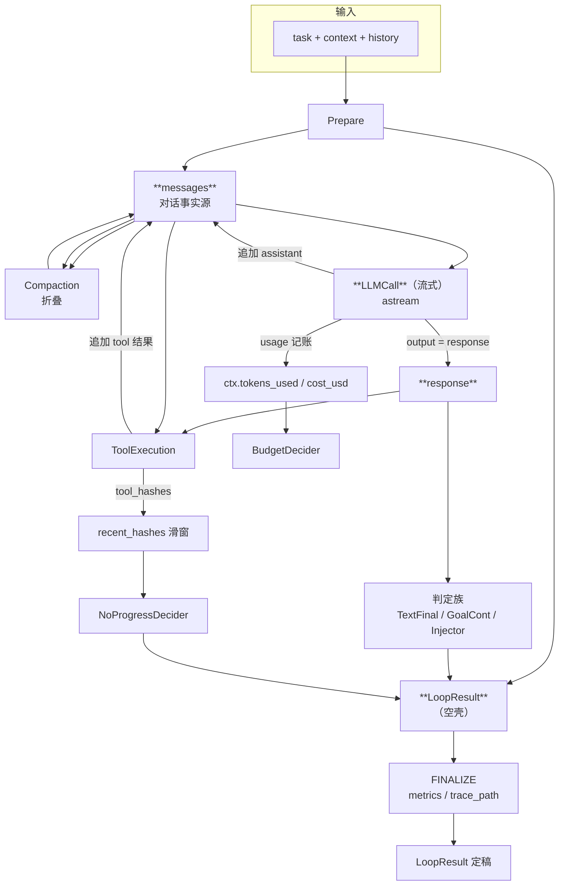
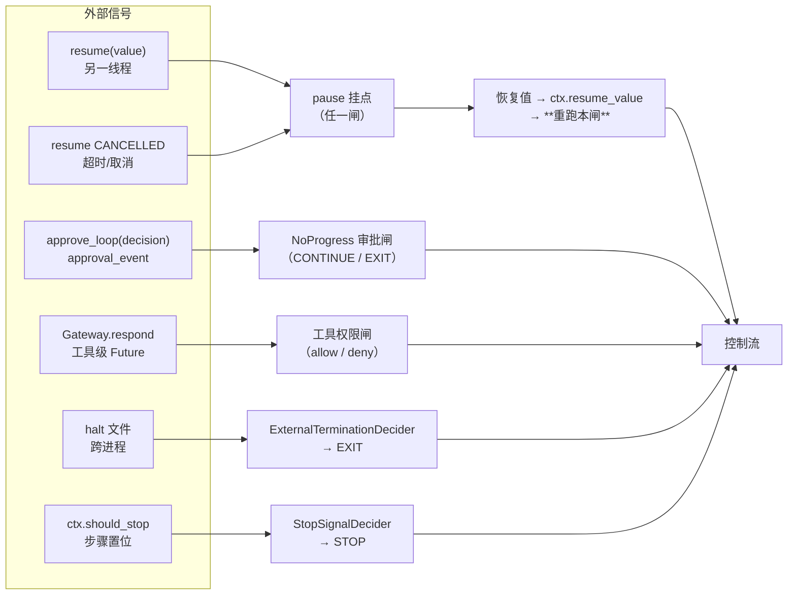
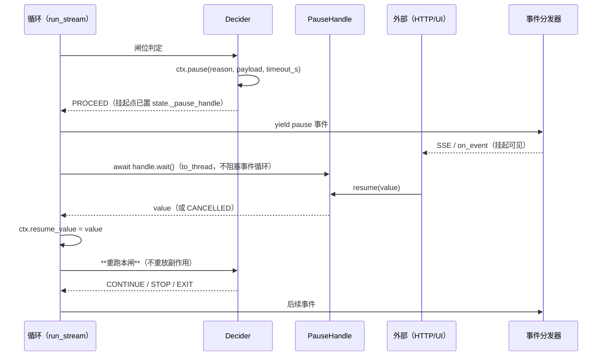
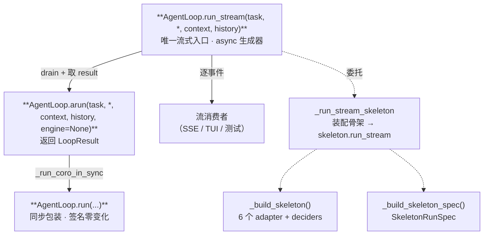

# 统一 Loop 最终设计：Decider + Step（2026-11-12）

> **性质**：实施设计（终态架构规范 · 决策已锁定 · 本文档只描述目标态，不含迁移步骤）
> **上位文档**：`loop-unification-design-20261111.md`（决策 D1-D9 与批次）·
> `loop-engine-industry-survey-20261111.md`（业界证据）· `loop-engine-inventory-20261111.md`（现状）
> **一句话**：**一个循环体（run_stream）+ 两族协议（Decider 判定 / Step 变形）+
> 一个分发器（事件三写）+ 一个漏斗（FINALIZE 幂等）+ 一个 HITL 原语（pause/resume）**。
> StepResult 是唯一线上货币。

---

## §0 设计公理（五条，不可妥协）

| # | 公理 | 反面（明确拒绝）|
|---|---|---|
| 1 | **单一循环体**：`run_stream` 是唯一的循环实现；`arun`/`run` 是它的两个包装 | 双循环体、双引擎分域 |
| 2 | **两族协议，一种货币**：Decider 与 Step 都产出 `StepResult`——**Decider 的 output 是裁决**（`(Decision, reason)`，驱动控制流）；**Step 的 output 是结果**（数据产物，驱动数据流）。事件随 StepResult.events 走，不靠回调副作用 | 事件靠回调副作用、ctx 变异即返回值 |
| 3 | **一切出口走漏斗**：FINALIZE 幂等，恰一次 | 提前 return、双发收尾事件 |
| 4 | **注入优先**：kernel 不 import 宿主（interfaces/cli）；依赖构造注入 | `bind_agent_loop` 式运行时绑定 loop 引用 |
| 5 | **裁决与副作用分离**：Decider 只读判定；副作用（预算记账、hash 窗口、事件发射）归 Step | decider 里发事件/记账 |

---

## §1 组件清单（终态）

### 1.1 判定族（Decider 协议）

```
Decider
  handle(input, ctx) → StepResult{output=(Decision, reason)}   ← 线上格式
  decide(input, ctx) → (Decision, reason)                      ← 子类实现
```

| 组件 | 闸位 | 判定 |
|---|---|---|
| `MaxIterationsDecider` | precheck | iteration > max → STOP("max_iterations") |
| `BudgetDecider` | precheck + after_reason | 三维预算超 → STOP("budget:…") |
| `CircuitBreakerDecider` | precheck | 熔断开 → CONTINUE("circuit_breaker_open") |
| `ExternalTerminationDecider` | precheck | halt 注入命中 → EXIT("halt") |
| `GoalContinuationDecider` | after_reason | goal 续跑 → CONTINUE |
| `InjectorContinuationDecider` | after_reason | injector(order≥100) 追加 → CONTINUE |
| `StopSignalDecider` | after_reason | ctx.should_stop → STOP(透传 reason) |
| `TextFinalDecider` | after_reason | 无 tool_calls → STOP("final_text") |
| `NoProgressDecider` | after_act | hash 滑窗命中 → 审批/挂起 → EXIT 或 PROCEED |

**闸位语义 = OR 组合**：序列按序判定，首个非 PROCEED 生效。
**`and_` 组合子移除**（无消费者；真 AND 语义「两票同意才停」无用例定义，等真实需求再按语义实现）。

### 1.2 变形族（Step 协议）

```
StepHandler      handle(input, ctx) → StepResult                    ← 一次性变形
StreamingHandler stream(input, ctx) → AsyncIterator[dict | StepResult] ← 流式变形
                  （最后一个 yield 恒为 StepResult）
Pipeline(*steps) 串行组合：上一 output = 下一 input，events 累积，fail-fast
```

| 步骤 | 协议 | 职责 | input → output |
|---|---|---|---|
| `PreRunStep` | StepHandler | pre-run 上下文前缀 + 注入器(order=0) | task → full_task + 初值 messages |
| `CompactionStep` | StepHandler | 历史超阈值 → 折叠（失败回退原样）| messages → messages' |
| `LLMCallHandler` | **StreamingHandler** | 事件流（deltas）+ LLM 调用 + 预算记账 + assistant 消息追加 | messages → LLMResponse |
| `ToolExecutionHandler` | StepHandler | 权限闸 → 执行（只读并行 gather）→ 结果进 messages | response → tool 结果 |
| `FinalizationStep` | StepHandler | metrics + claim validation | result → result' |

**LLMCall 是唯一的流式步骤**——这是数据与信号的交汇点（§6）。

### 1.3 骨架（驱动器 + 分发器 + 漏斗）

| 组件 | 职责 |
|---|---|
| `run_stream` | 状态机驱动（§3 逻辑流）|
| **分发器（Distributor）** | 唯一事件出口：步骤产出的事件 → **三写**（run_stream / on_event 总线 / trace 账本）；骨架自身事件（pause/error/done）同路 |
| `FINALIZE 漏斗` | 一切出口的收尾（幂等，§8）|
| `pause 装配` | `attach_pause(ctx)` 工厂 + await 恢复 + 闸位重跑 |

### 1.4 共享状态

`LoopContext`（**保持可变**——完全不可变是更大的重构，不做）：步骤经 ctx 读写
messages / response / should_stop / tokens_used / resume_value 等；新增 `pause`
工厂（装配注入）与 `resume_value`。

---

## §2 逻辑流（状态机全图）

```
ATTACH      事件分发器接管（bus + run_stream 双写）；pause 工厂装配
│
├─ Prepare（StepHandler）
│    task/context/history → full_task + LoopResult(新) + messages 初值
│    事件: loop_start
│
├─ FOR iteration = 1 .. max_iterations：
│   │
│   ├─【PRECHECK 闸】MaxIter → Budget → CircuitBreaker → ExternalTerm
│   │    PROCEED ─────────────────────────────► 继续
│   │    STOP(budget) ────────────────────────► FINALIZE(finished=budget)
│   │    STOP(其他) ──────────────────────────► FINALIZE(finished=stop)
│   │    EXIT(halt) ──────────────────────────► FINALIZE(finished=exit)
│   │    挂起 ──► pause 事件 → await 恢复 → 恢复值入 ctx → 重跑本闸
│   │
│   ├─【REASON】Compaction → LLMCallHandler（流式）
│   │    Compaction 失败 → 原样回退（不阻断）
│   │    LLMCall: iter_start → llm_request → deltas → llm_usage → response
│   │    流中断/LLMError ──► error 事件 ──► FINALIZE(finished=error)
│   │    超时(骨架对流的 wait_for) ─────────► FINALIZE(finished=timeout)
│   │
│   ├─【DECIDE① after_reason 闸】Budget → GoalCont → Injector → StopSignal → TextFinal
│   │    TextFinal(STOP) ──► answer=response.content ──► FINALIZE(finished=stop)
│   │    CONTINUE(goal/injector) ──► 跳过 ACT，直接 OBSERVE
│   │    STOP(budget/stop_signal) ────────────► FINALIZE
│   │    挂起 ──► 同上
│   │
│   ├─【ACT】ToolExecutionHandler
│   │    response.tool_calls → 权限闸（fail-closed）→ 执行 → 结果进 messages
│   │    失败 ──► error 事件 ──► FINALIZE(finished=error)
│   │
│   ├─【DECIDE② after_act 闸】NoProgress（+审批挂起 / +halt 兜底）
│   │    EXIT(user_rejected / approval_timeout_rejected) ──► FINALIZE(保留精确 finished)
│   │    STOP ────────────────────────────────► FINALIZE
│   │    PROCEED ─────────────────────────────► OBSERVE
│   │
│   ├─【OBSERVE】after_iteration hook
│   ├─【DECIDE③ after_observe 闸】（预留空闸，默认恒 PROCEED）
│   │    非 PROCEED ──► FINALIZE（stop / exit）
│   └─ 循环 → 下一轮
│
├─ FOR-ELSE（耗尽）：finished=max_iter → FINALIZE（补终答文案）
├─ EXCEPTION：error → FINALIZE(finished=error)
│
├─【FINALIZE 漏斗 · 幂等 · 恰一次】
│    finished=budget → budget_exhausted 事件
│    loop_end → assistant_message（有答案时）→ iter_end
│    max_iter 且无答案 → 补 "Reached max_iterations=N…" 文案
│    FinalizationStep：metrics + claim validation
│    git commit（auto_git_commit 时）→ trace close → result.trace_path
│    after_run hook（恰一次）
│
└─ DETACH（事件分发器还原）→ done 事件（循环体终态，恰一次）
```

** Decision 语义终表**：

| Decision | 状态机行为 |
|---|---|
| `PROCEED` | 本闸放行，进入下一步骤 |
| `CONTINUE` | 跳过本轮剩余步骤，直接下一轮迭代 |
| `STOP` | 结束循环 → FINALIZE（finished_reason 按映射）|
| `EXIT` | 结束整个 run → FINALIZE（保留精确 finished，如 user_rejected / halt）|

**组合语义**：闸位序列本身即 OR 组合（任一非 PROCEED 生效）。`and_` 移除——
真 AND（两票同意才停）无消费者且语义未定义，等真实需求。

---

## §2A 完整消费流程（一条消息的全生命周期走查）

> 把 §2 逻辑流 / §3 数据流 / §4 信号流**串起来跑一遍**。
> 场景：web chat 会话里，用户发送「帮我分析20日动量因子在A股的IC表现」，
> 带 2 轮历史。第 1 轮模型要求读文件，第 2 轮给出终答。
> 【组件】= 该步由谁执行；【数据】= 此刻的关键数据状态；【信号】= 此刻发出的信号。

---

### 阶段 0 · 消息接入（循环体之外）

| # | 【组件】动作 | 【数据】 | 【信号】 |
|---|---|---|---|
| 0.1 | HTTP `POST /api/chat` 收到 `{session_id, message}` | message = "帮我分析…" | — |
| 0.2 | session service：加载 session → **history**（含 1 条历史 checkpoint）| history = [system, user①, assistant①] | — |
| 0.3 | 装配/复用 AgentLoop（`build_chat_agent_loop`）：**注入** halt_check、PermissionGateway、on_event→SSE、registry、hooks、compaction 配置 | 装配完成的 AgentLoop | — |
| 0.4 | 调用 `arun(message, history=history)` → 即 **drain(run_stream)** | task = message | — |

**以下全部发生在 `run_stream` 生成器内部。**

---

### 阶段 1 · 循环体启动

| # | 【组件】动作 | 【数据】 | 【信号】|
|---|---|---|---|
| 1.1 | 分发器接管：`_on_event` 包一层（bus 照发 + 事件压 pending→run_stream）| — | —（桥建立）|
| 1.2 | `attach_pause(ctx)`：pause 工厂装进 ctx | ctx.pause 可调用 | — |
| 1.3 | **Prepare**（StepHandler）：goal/memory 注入 → full_task；创建 **LoopResult**；messages = [system] + history + [user(full_task)] | **messages 初值就绪**；result 全零值 | `loop_start` |
| 1.4 | guardrail 扫描**原始 task**（发现即报，不改消息）| — | `guardrail.finding`（如有）|
| 1.5 | `before_run` hook | — | — |

---

### 阶段 2 · 迭代 1（ACT 路径：模型要求读文件）

| # | 步骤 | 【组件】动作 | 【数据】 | 【信号】|
|---|---|---|---|---|
| 2.1 | PRECHECK 闸 | 4 个 decider 按序判定：iteration 1 ≤ 5 ✅ / tokens=0 未超 ✅ / 熔断未开 ✅ / halt 无 ✅ | 全 PROCEED | — |
| 2.2 | **Compaction**（StepHandler）| 未超阈值 → 原样返回 | messages 不变 | —（超阈值才有 `compression`）|
| 2.3 | inbox drain + order=0 注入器 | 无待处理 | messages 不变 | — |
| 2.4 | `before_iteration` hook | — | — | — |
| 2.5 | **LLMCall**（StreamingHandler，逐步 yield）| `iter_start`→`llm_request`→`client.astream(messages, tools)`：**真 LLM 调用开始** | messages 不变（调用后追加 assistant）| `iter_start` · `llm_request` · `thinking_start/delta/done` · `text.started/delta×N` |
| 2.6 | LLMCall 收尾 | usage 记账（`_record_budget_usage` → ctx.tokens_used/cost_usd）；**messages += assistant(带 tool_calls: read 动量因子)** | **messages +1**；ctx.tokens_used=150 | `text.ended` · `llm_usage` · `llm_response` |
| 2.7 | DECIDE① after_reason 闸 | Budget ✅ / GoalCont 无 goal ✅ / Injector 无 ✅ / StopSignal ✅ / **TextFinal：有 tool_calls → 不是终答 → PROCEED** | 全 PROCEED → 进入 ACT | — |
| 2.8 | pre_act 闸（熔断）| 未开 → PROCEED | — | — |
| 2.9 | **ACT**（ToolExecutionHandler）：权限闸（read=只读 allow）→ 执行 read → 结果 | **messages += tool 结果**；tool_hashes 入窗；tool_calls_made=1 | `tool_call` · `tool_result` | |
| 2.10 | DECIDE② after_act 闸 | NoProgress：窗口未满 → PROCEED | PROCEED → OBSERVE | — |
| 2.11 | OBSERVE | `after_iteration` hook | — | — |
| 2.12 | DECIDE③ after_observe 闸（空）| 恒 PROCEED | → 迭代 2 | — |

---

### 阶段 3 · 迭代 2（终答路径：TextFinal STOP）

| # | 步骤 | 【组件】动作 | 【数据】 | 【信号】|
|---|---|---|---|---|
| 3.1 | PRECHECK 闸 | iteration 2 ≤ 5 ✅ / tokens=150 未超 ✅ / … ✅ | PROCEED | — |
| 3.2 | Compaction + LLMCall | **messages 已含 tool 结果** → LLM 拿到完整上下文 → 给出终答文本 | **messages += assistant(终答)**；tokens_used=300 | `iter_start` · `llm_request` · `text_delta×N` · `llm_usage` · `llm_response` |
| 3.3 | DECIDE① after_reason 闸 | **TextFinalDecider：无 tool_calls → STOP("final_text")** | **answer = response.content** | — |
| 3.4 | 退出循环（break）→ **FINALIZE 漏斗**（见阶段 4）| — | — | — |

---

### 阶段 4 · FINALIZE（幂等漏斗，恰一次）

| # | 【组件】动作 | 【数据】 | 【信号】|
|---|---|---|---|
| 4.1 | finished_reason=stop → 非 budget，跳过 `budget_exhausted` | — | — |
| 4.2 | `loop_end`（finished=stop）| — | `loop_end` |
| 4.3 | answer 非空 → `assistant_message` | — | `assistant_message` |
| 4.4 | `iter_end`（iterations=2）| — | `iter_end` |
| 4.5 | **FinalizationStep**：`_finalize_metrics`（elapsed/tokens → result.metrics）+ claim validation（可选）| **result.metrics 就绪** | `loop_final` |
| 4.6 | `_git_commit`（auto_git_commit 时）| — | — |
| 4.7 | **trace close** → `result.trace_path` | trace.jsonl 定稿 | — |
| 4.8 | `after_run` hook（`_after_run_fired` 幂等，恰一次）| — | — |
| 4.9 | DETACH（分发器还原 on_event）| — | — |
| 4.10 | **`done` 事件**（循环体终态，恰一次）| — | `done` |

---

### 阶段 5 · 出口（回到调用方）

| # | 动作 |
|---|---|
| 5.1 | `arun` 返回 **LoopResult**（answer=终答 / finished=stop / iterations=2 / usage / trace_path）|
| 5.2 | service 层：LoopResult → SSE 完结 / API 响应；messages → session 持久化 |

---

### 异常分支走查（同上各阶段，仅列分叉点）

| 分支 | 从哪分叉 | 走向 | 与主路径的差异 |
|---|---|---|---|
| 预算耗尽 | DECIDE① Budget STOP（或 PRECHECK）| FINALIZE(finished=budget) | FINALIZE 先发 `budget_exhausted`（载荷：reason/tokens_used/cost_usd/elapsed）|
| LLM 错误 | REASON 失败 | FINALIZE(finished=error) | error 事件 + on_error hook；流回退（SSE 失败 → achat）是 handler 内部细节 |
| 工具失败 | ACT 失败 | error 进 messages（**不终止**）→ 下一轮模型看到错误 | 与成功轮同构 |
| no-progress 拒绝 | DECIDE② NoProgress EXIT | FINALIZE(finished=user_rejected / approval_timeout_rejected) | 审批闸已发 loop_end/assistant_message/iter_end → `_ending_emitted` 幂等，FINALIZE 跳过三件套但跑 metrics/git/trace |
| halt | PRECHECK ExternalTerm EXIT | FINALIZE(finished=exit) | 停止原因=halt |
| 权限 ASK | ACT 内 | 工具暂停等 gateway（**循环不挂**，其他工具继续）；无通道 → fail-closed deny | — |
| pause/resume | 任一闸（decider 调 ctx.pause）| yield pause/agent_paused → await → 恢复值入 ctx → **重跑本闸**（不重放副作用）| — |
| 挂起期间 | — | **事件循环仍响应**其他请求（await 而非同步 wait）| — |
| 上限耗尽 | FOR-ELSE | FINALIZE(finished=max_iter) | 补 "Reached max_iterations=N…" 终答文案 |


## §2B 流程图（Mermaid）

> 六张图：① 总览（入口→循环→出口）② 单轮状态机 ③ 事件分发（三写）
> ④ 数据流 ⑤ 信号流（六条入向）⑥ HITL 挂起/恢复时序

### 图 1 · 总览：入口 → 循环 → 出口



### 图 2 · 单轮状态机（一轮迭代的九个判定点）



### 图 3 · 事件分发（分发器三写）



### 图 4 · 数据流（对象 → 谁写 → 谁读）



### 图 5 · 信号流（六条入向 → 各自汇入点）



### 图 6 · HITL 挂起/恢复时序



---

## §2C 入口契约（U5.5 已落地 · 2026-11-12）

> 终态三条入口已就位。本节记录**实际形状**与**有意非对称**。

### 入口金字塔（现状）



### 三条不变 + 一处非对称

| 项 | 内容 |
|---|---|
| `run()` 签名零变化 | 4 个生产调用方 + 175 处测试不动 |
| `arun()` 保留 `engine` | U6-2 滞后期间 legacy 仍需可达（遗产网依赖）|
| `run_stream()` **不接受 `engine`** | **有意非对称**——legacy 没有流式入口（事件走 `_emit` 副作用，不进生成器），暴露只会拿到残缺流，是 API 陷阱 |
| 一次运行消费一次 | `AgentLoop` 持有 `_strategy` / `_skeleton_ctx` 等可变状态，同实例重复 run 未定义 |

### 提取的三个方法（纯重构，零行为变化）

| 方法 | 职责 |
|---|---|
| `_build_skeleton()` | 构造 `ReActSkeleton` + 6 个 adapter + `deciders_for(halt_check=…)`；结果存 `self._skeleton` |
| `_build_skeleton_spec(task, context, history)` | 构造 `SkeletonRunSpec` |
| `_run_stream_skeleton(task, context, history)` | 装配 + 驱动骨架 `run_stream`（`run_stream` 与 `_run_via_skeleton` 的共同委托目标）|

`_run_via_skeleton` 退化为**薄包装**（`drain(_run_stream_skeleton)` + `_skeleton_result()`），
不再直接构造骨架——装配逻辑单点。

### 收益（U5.5 解决了什么）

| 之前 | 之后 |
|---|---|
| 想流消费必须绕过 AgentLoop **手工搭 6 个 adapter**（`test_run_stream_dual_channel` 原写法）| 直接用 `AgentLoop.run_stream`（**生产同源**）|
| 装配逻辑散落在 loop 私有方法与测试里各一份 | 单点（`_build_skeleton`）|
| `arun` 与「流式」是两条实现 | 同源（`arun` = drain `run_stream`）|

**验证网**：`tests/test_entry_unification.py`（6 条）——run_stream 存在/可迭代·
done 恰一次·**无 engine 参数**（非对称钉住）·arun 走 run_stream（spy）·
run/arun 结果一致·装配方法已提取。

---

## §3 数据流（数据对象 · 生产者 · 消费者）

### 3.1 数据对象

| 对象 | 形态 | 生命周期 |
|---|---|---|
| **messages** | `list[dict]`——对话事实源（system → history → user → assistant(tool_calls) → tool → …）| Prepare 初值 → 每轮被 Compaction/LLMCall/ToolExec 变异 → Finalize 后随 result 持久化 |
| **response** | `LLMResponse{content, tool_calls, usage, finish_reason}` | LLMCall 产出 → 判定族/ACT/Finalize 消费 → 随轮次被下一轮覆盖 |
| **LoopResult** | `{answer, stop_reason, finished_reason, iterations, tool_calls_made, success, usage_*, metrics, trace_path, error, messages}` | Prepare 创建 → 各步骤/闸位填写 → FINALIZE 定稿 → 调用方 |
| **LoopContext** | 共享可变容器（上表字段 + 预算 + pause/resume_value + metadata）| Prepare 创建 → 穿线全部步骤/闸位 → run 结束即弃 |
| **StepResult** | `{output, events[], success, error}` | 每步骤产出 → 骨架消费（事件 → 分发器；output → 下一环节）|
| **trace.jsonl** | 事件账本（含 raw 字段）| TraceWriter 逐条写 → FINALIZE 关闭 → trace_path 交调用方 |

### 3.2 Who-Write-Who-Read（LoopContext 字段级数据流）

| 字段 | 写者 | 读者 |
|---|---|---|
| `messages` | Prepare(初值) · Compaction(折叠) · wrap-up nudge(插 system) · LLMCall(追加 assistant) · ToolExec(追加 tool 结果) | Compaction / LLMCall / ToolExec / hooks |
| `iteration` | 骨架 | 全部闸位 / hooks / Finalize |
| `response` | LLMCall | TextFinal / GoalCont / Injector 判定、ToolExec |
| `should_stop` / `stop_reason` | StopSignal(错误置位) · BudgetStopStep(超支置位) | StopSignalDecider / BudgetStopStep |
| `tokens_used` / `cost_usd` | LLMCall(记账) | BudgetDecider / BudgetStopStep / Finalize(metrics) |
| `recent_hashes`（窗口）| ToolExec(record) / NoProgress(清理) | NoProgressDecider |
| `resume_value` | 骨架(await 恢复后写入) | 重跑的 decider |
| `result` | Prepare(创建) · 审批闸(finished_reason) · TextFinal(answer) · Finalize(metrics/trace_path) | 全部 |

### 3.3 数据不变量

1. **messages 单调追加为主**：只有 Compaction 折叠与 wrap-up 插入是例外（均有确定性触发条件）。
2. **usage 只增不减**：预算判定是纯读。
3. **finished_reason 一经闸位写入不被覆盖**：FINALIZE 只在缺省时补默认值（max_iter 补文案同理）。
4. **response 每轮覆盖**：跨轮读取一律走 messages（assistant 轮次），不走 ctx.response。

---

## §4 信号流（四条出向通道 + 入向信号）

### 4.1 出向通道（分发器三写 + run_stream）

**分发器（Distributor）是唯一事件出口**：步骤产出的每个事件、骨架自身的每个事件，
都经分发器**三写**：

```
步骤 yield / StepResult.events
        │
        ▼
┌─────────────────┐
│  分发器 Distributor │
└─────────────────┘
   │            │            │
   ▼            ▼            ▼
 S1 run_stream  S2 on_event  S3 trace.jsonl
 (流契约)        (事件总线/SSE)  (诊断账本)
```

| 通道 | 消费方 | 契约 |
|---|---|---|
| **S1 run_stream** | arun/run 的 drain、直接流消费者 | delta + 生命周期 + `pause`/`error`/`done`（done 恰一次，终态）|
| **S2 on_event 总线** | SSE 转发 / event_log 持久化 / swarm 回调 | 总结级词表（event_vocab）|
| **S3 trace.jsonl** | 诊断 / Trajectory View | 全量含 raw 字段 |

**事件清单（生产步骤 → 类型）**：

| 生产者 | 事件 |
|---|---|
| Prepare | `loop_start` |
| LLMCall | `iter_start` · `llm_request` · `thinking_start/delta/done/end` · `text.started/delta/ended` · `llm_response` · `llm_usage` |
| ToolExec | `tool_call` · `tool_result` · `tool_error` |
| Compaction | `compression` / `compact` |
| 审批闸 / guardrail | `agent_approval_requested` · `agent_approval_responded` · `guardrail.finding` |
| FINALIZE | `budget_exhausted` · `loop_end` · `assistant_message` · `iter_end` · `loop_final` |
| 骨架 | `pause` · `agent_paused` · `error` · `done` |

### 4.2 入向信号（外部 → 循环）

| 信号 | 入口 | 汇入点 | 语义 |
|---|---|---|---|
| `resume(value)` | PauseHandle（另一线程）| 挂起中的闸 → 恢复值写 `ctx.resume_value` → 闸位重跑 | 人工判断注入 |
| `approve_loop(decision)` | approval_event（三步序）| no-progress 审批闸 | 批准继续 / 拒绝退出 |
| `PermissionGateway.respond` | 工具级 Future | 工具权限 ASK | allow / deny |
| halt 文件（跨进程）| `halt_check()` 注入 | PRECHECK 闸 EXIT | 全局终止 |
| `ctx.should_stop` | 步骤置位 | StopSignalDecider | 步骤内失败信号 |

### 4.3 信号三条不变量

1. **done 恰一次**：一切出口（含挂起恢复后终止）最终都产生恰好一个 `done`。
2. **事件不重放**：pause 恢复只重跑闸位判定，**不重放**挂起前的副作用事件。
3. **分发器单点**：除分发器外任何组件不得直接写 S1/S2/S3（审计器验证 trace 写入仅经分发器）。

---

## §5 交汇点：LLMCall（数据流与信号流的唯一交汇）

LLM 调用是**数据变换**（messages → response）与**信号发射**（逐 chunk delta）
同时发生的地方——这也是它是唯一 StreamingHandler 的原因：

```
LLMCallHandler.stream(messages, ctx):
    yield iter_start / llm_request                 ← 信号
    for chunk in client.astream(messages, tools):
        thinking → yield thinking_delta            ← 信号
        content  → yield text_delta                ← 信号
                   messages 累积 / usage 记账       ← 数据
        tool_calls → 累积                          ← 数据
    yield thinking_end / text.ended / llm_usage    ← 信号
    ctx.messages += assistant(response)             ← 数据
    yield StepResult.ok(output=response)           ← 终止信号（数据）
```

**骨架的 drain 契约**：逐个 yield 转发分发器（三写）；遇 `StepResult` 收束；
`asyncio.wait_for` 包整个 drain（超时 → `StepResult.fail("timeout")` → FINALIZE）。
**流式回退**（provider 不支持 SSE → chat）是 handler 内部实现细节，契约不变。

---

## §6 HITL：三层的终态关系

| 层 | 原语 | 粒度 | 恢复语义 |
|---|---|---|---|
| **循环级（H1，本设计核心）** | `ctx.pause(reason, payload, timeout_s) → resume_value` | 整个循环挂起 | **原地恢复**（闸位重跑，恢复值注入，无副作用重放）|
| 工具级（既有）| PermissionGateway ASK | 单次工具调用 | allow / deny（无注入）|
| 进程级（既有）| halt → ExternalTerminationDecider | 全局 | 无（EXIT）|

审批逻辑（no-progress 审批）**迁移到循环级原语是 U6 后可选批**：迁移时按
approve / prompt / select 三型设计（lobehub 参照）。跨进程/跨会话恢复
（信封先落盘再 inline 连跑，lobehub `continuation.ts` 参照）**明确不在本设计内**，
仅在 H1 需要持久化时作为实现参考。

---

## §7 出口矩阵（终态）

| 出口 | finished_reason | 触发 | 挂起可恢复 |
|---|---|---|---|
| 终答 | `stop` | TextFinalDecider | — |
| 预算 | `budget` | BudgetDecider / BudgetStopStep | — |
| 上限 | `max_iter` | for-else | — |
| 拒绝 | `user_rejected` / `approval_timeout_rejected` | NoProgress 审批闸 | 审批是即答型 |
| 外部终止 | `exit`（stop_reason=halt）| ExternalTerminationDecider | — |
| 挂起取消 | 走取消分支（decider 决定 stop/continue）| pause CANCELLED | — |
| 错误 | `error` | LLM / 工具 / 骨架异常 | — |

**收尾保证**（六项，出口网钉住）：`trace_path` 非空 · trace 已关 ·
`loop_end`/`iter_end`/`after_run` 各恰一次 · `done` 恰一次。

---

## §8 边界（明确不做）

| 不做 | 理由 |
|---|---|
| 内建 checkpoint / durable / 跨进程恢复 | 编排层已有 checkpoint_store；lobehub 的 21k 僵尸行 + 2000 行协调代码是运营成本反证 |
| kernel 循环图化 | 编排已有 GraphEngine/workflow 层 |
| CodeAct 动作空间 | reasoner 形态选择，与 loop 正交 |
| 嵌套挂起 / 挂起栈 | 单次挂起不变量（H1）；需要时另立设计 |
| `and_` 组合子 | 无消费者且语义未定义；闸位序列即 OR，等真实 AND 用例 |
| `pre_act` 空闸调用 | 批次 10 已把 resilience 并入 precheck，残留调用移除 |
| 审批逻辑迁移到 pause/resume | U6 后可选批（approve/prompt/select 三型参照）|

---

## §9 与旧形态的差异速查（评审锚点）

| 维度 | 旧（切换前）| 终态（本设计）|
|---|---|---|
| 循环体 | 2 个（legacy + skeleton）| 1 个（run_stream）|
| 入口 | 4 个跨 2 类 | 金字塔 3 个（run_stream → arun → run）|
| 步骤协议 | `execute(ctx, async_mode)` 变异 ctx | `handle/stream(input, ctx) → StepResult` |
| 事件 | `_emit` 副作用 + 事件桥 tap | 步骤产出 → 分发器三写（桥退役）|
| async | `async_mode` bool 三处同型分派 | 全 async，`maybe_await` 一处收口 |
| 外部终止 | 无（halt 在闸外）| ExternalTerminationDecider（precheck 注入）|
| HITL | 一问一答 ×3 | pause/resume 原语 + 既有两层保留 |
| 预算 | 停（二值）| 停 + `budget_exhausted` 信号（三策略列为 backlog）|
| `StopPolicy`（runtime/policy.py）| legacy 内消费 | **U6 处置待定**：删，或保留为 costLimit 三策略内核 |

---

## 附 · 本设计的验证资产

| 网 | 钉什么 |
|---|---|
| 出口收尾网 | 9 出口 × 6 断言（漏斗契约）|
| 事件序列网 | no-progress 序列绝对值 |
| 双通道网 | delta 顺序 / 负向 / 工具共存 |
| 挂起网 | 三条不变量 + 事件循环响应 |
| 遗产网 | legacy 特有行为显式钉住（U6 删）|
| 审计命令 | legacy 残留可独立发现（R-015 ④）|
| 决策单元网 | decider 判定 / 组合 / 注入 |

