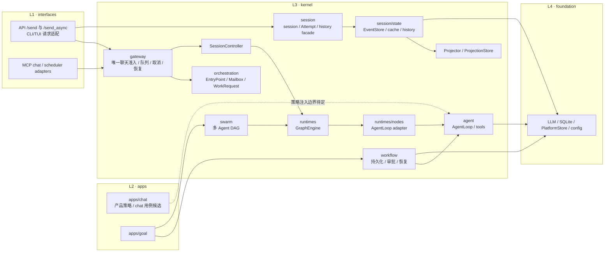

# 项目架构复评与渐进式重构计划

> **日期**：2026-11-18<br>
> **状态**：架构复评与实施建议；待讨论确认，本文不授权代码迁移或删除。<br>
> **审查范围**：四层依赖方向、关键模块语义落位、状态/历史读写契约、能力注册、组合根与执行路径。
> **基线说明**：结论来自当前工作区的只读检查及现有架构门禁。State 簇迁移仍有在途工作，本计划要求先验收在途变更，再开始新的边界调整。

## 0. 结论摘要

项目的四层主结构总体成立：

```text
L1 interfaces  →  L2 apps  →  L3 kernel  →  L4 foundation
```

当前没有证据支持推翻分层或全面搬迁目录。已运行的 `scripts\batch_gate.cmd` 全部通过，层级方向违规为 0；但静态门禁主要验证可识别的导入方向，不能单独证明运行时装配、数据事实源和同层职责划分都一致。

本轮架构复评建议聚焦以下事项：

1. **先收尾 State 簇迁移**，校准它的装配、测试与进展文档。
2. **统一会话历史的事实源与读取契约**，明确 `MemoryManager` 的实际职责和消费者。
3. **重新裁决 `SessionService` 边界**，避免把跨域聊天编排全部归入 `kernel/session`。
4. **显式化 capability 注册时机**，消除对 Python import 顺序和副作用的隐式依赖。
5. **按业务语义复核内置工具**，尤其是 `OptionsPricingTool`。
6. **收敛 API 装配路径与执行路径的歧义**，但不把职责不同的执行引擎强行合并。

计划采取渐进式、可回滚的方式。每项迁移先确定契约，再做最小代码变更；不以减少文件数或目录层级作为目标。

## 1. 目标与非目标

### 1.1 目标

- 让每个主要模块有可解释的所有者、输入输出和生命周期。
- 保持静态依赖方向，并补足静态检查无法覆盖的运行时契约。
- 对 `event_log`、`messages`、缓存及投影建立单一、可测试的权威关系。
- 让 API、TUI 等入口在服务构造、关闭、降级和错误传播上行为一致。
- 保持面向用户的 API、CLI、聊天、事件流和会话语义不变，除非单独批准行为变更。
- 以小批次提交和明确回滚边界降低重构风险。

### 1.2 非目标

- 不进行一次性推倒重写或全项目目录重排。
- 不因类名相似而合并 AgentLoop、GraphEngine、SwarmRuntime。
- 不在未确认消费者与兼容契约前删除 `MemoryManager`、registry 或旧执行路径。
- 不在本计划中引入新的依赖注入框架、全局服务定位器或统一超级容器。
- 不把当前工作区已有的 State/Foundation 改动混入新的架构重构批次。

## 2. 当前结构与落位判断

| 层 / 区域 | 当前判断 | 结论 |
|---|---|---|
| `interfaces` | API、TUI 作为入口和组合根，依赖 apps/kernel 合理；API container 与 fallback providers 有重复装配，dependencies 还依赖 router 私有 helper | **保留层级，整理内部装配边界** |
| `apps` | `apps/chat` 已承载 persona、shell 开关等产品策略，`apps/goal` 调用 kernel workflow/swarm 符合向下依赖 | **总体合理；继续承接产品用例与业务能力** |
| `kernel/session` | SessionStore、Projector、session 元数据/attempt 等属于会话平台能力；SessionService 同时承担 `/send_async` 的队列/AgentLoop 执行，并被 `/send` 的 Gateway 路径用于历史和事件存取 | **保留会话内核；先裁决两条聊天执行路径，再决定拆分** |
| `kernel/session/state` | EventStore、MemoryManager、缓存、投影端口以 session 为主要键并协作于 session 生命周期 | **目标目录合理；完成迁移验收和读写契约校准** |
| `kernel/agent` | AgentLoop 与通用 agent 机制适合位于 kernel；内置工具包与 agent 有紧密耦合 | **整体保留；按单个工具语义决定归属** |
| `kernel/runtimes`、`kernel/workflow`、`kernel/swarm` | 图执行、工作流、多 Agent 协作属于不同执行机制 | **分别保留；明确调用边界，不预设合并** |
| `foundation` | 配置、LLM、存储、观测等基础设施在 L4；当前门禁未发现实际向上静态导入 | **层级合理，按现有 Foundation 计划单独验收** |
| `evals` | 位于 L3 是因其直接构造/驱动被测 AgentLoop；但语义上属于评测支持面 | **作为显式例外记录，不按生产 kernel 模块简单类推** |

现有依赖图记录 `kernel/session → kernel/agent` 为 13 条边，是值得降低的跨簇耦合信号，但不是必须清零的硬指标。应以真实调用链和职责归属判断是否拆分，不能为了数字而增加抽象。

## 3. 架构问题清单

### A1. State 簇迁移与进展文档需先闭环

State 簇已从 `kernel/agent` 迁至 `kernel/session/state`，其归属理由与 session 数据键、生命周期一致。当前工作区仍有相关代码、测试及文档变更，必须先完成在途批次验收。

设计文档 §16.3 仍保留迁移前的装配缺口描述；§16.6 又记录缺口已修复。实施结束时应统一“目标约定、当前实现、验证结果”，避免后续阶段依据过时缺口重复改动。

### A2. 会话历史存在多条读取路径，权威语义需落实到代码

设计约定为：

- `event_log` 是会话消息时间线事实源；
- `messages` / `message_parts` 是由 Projector 写入、可重建的读模型；
- `clear` 添加边界事件，不等于删除历史。

当前实现和调用关系需要进一步确认：

- SessionStore 优先通过 event log / projector 读历史，在失败路径可能退回 messages 投影；
- UnifiedMemoryManager 的读取实现可直接读 messages；
- 生产引用搜索中，MemoryManager 主要出现在 API/TUI 构造与 `/clear` 路径，未见明确的生产 `append/get` 调用者；
- MemoryManager 可懒建自己的 EventStore，而 API container 也管理 EventStore，需明确这是不是有意的组件所有权设计。

这不自动代表数据错误，但如果 event log 是唯一事实源，则“投影损坏时直接退读投影”与“从 event log 重建/修复”的契约需要明确。任何降级读取都应可观察、可诊断，并有针对性测试。

### A3. SessionService 与 Gateway 形成两条活跃聊天执行路径

当前 API 至少有两条不同的聊天执行路径：

- `/send_async` 调用 `SessionService.send_message()`，由 SessionService 管理 per-session FIFO 队列、attempt 和 AgentLoop 执行；
- `/send` 走 `Gateway → EntryPoint → SessionController → GraphEngine`，但仍通过 SessionService 读取历史、转换上下文和写入事件；
- TUI 当前通过 `get_gateway()` 使用 Gateway 路径。

因此 SessionService 不只是“一个职责过多的 chat service”，Gateway 也不只是另一个名字的服务。两条路径的受理、排队、attempt/run 标识、取消/恢复和事件持久化需要对照后才能判断是否收敛。不能仅凭目录和类名直接合并。

**决策（2026-11-18，用户已接受）**：Gateway 是唯一聊天执行控制面。`/send_async` 后续改为 Gateway 的入口适配，不再由 SessionService 保留第二套 FIFO/AgentLoop 执行队列；`/send` 与 TUI 延续 Gateway 路径。

`SessionService` 同时处理 session 生命周期、`/send_async` 的队列/attempt、AgentLoop 调用、persona/system prompt、压缩等。其当前类文档仍称 API/TUI 共用，需按真实入口更新。建议分别识别：

- session 元数据、attempt、持久化、生命周期：倾向留在 `kernel/session`；
- 面向用户的聊天请求编排、产品策略、特定 prompt/persona：评估由 `apps/chat` 承担；
- AgentLoop 构造与 kernel 运行机制：由 kernel 提供明确端口/工厂，避免 apps 反向控制内核细节。

迁移前须先确定 `/send_async` 响应、事件和 attempt 契约映射；保留 endpoint 和用户可见兼容，不得直接删队列实现。

### A4. CapabilityRegistry 的运行时注册依赖隐式

静态依赖方向允许 apps 向 kernel capability port 注册能力，但当前运行时实现探测 `sys.modules`，并依赖 apps 导入副作用注册。这样能力可用性会受 import 顺序影响，且注册阶段的异常可能不够显式。

目标是保留 kernel 定义的 capability port，由组合根显式提供/注册 app capabilities；不让 kernel 反向导入 apps，也不依赖“先碰巧 import 某个包”。

### A5. API 有多条服务装配路径

API container 与 fallback dependencies 都存在构造服务的路径；dependencies 还从 `routers.chat` 取得私有 permission gateway helper。TUI 也有自己的合法 composition root，但各入口应共享装配契约，避免常规启动与 fallback、API 与 TUI 在 Projector/EventStore/MemoryManager 配置上漂移。

目标不是让所有入口共用一个全局容器，而是：

- 每个入口继续拥有自己的生命周期；
- 入口调用共享的、明确的 builder/构造函数；
- 请求 handler 不负责资源拥有权；
- 创建的资源有成对的关闭路径。

### A6. OptionsPricingTool 的语义可能应由 Apps 提供

Black–Scholes 定价有明确量化业务语义，当前却作为通用 kernel builtin tool 注册。建议把它作为单个工具的落位决策：若它是产品/量化应用能力，则通过 apps capability 注入；若维护者确认它是通用示例或平台默认能力，应记录理由和默认可用性预期。

不要因此迁出整个 `builtin_tools` 包；包级依赖关系比单个工具的语义归属更重要。

### A7. 执行入口并存需要按职责评估

AgentLoop/LoopEngine、GraphEngine、SwarmRuntime、WorkflowRunner 分别可能承担单 Agent 循环、通用图执行、多 Agent 协作和可暂停/恢复的持久化工作流，职责不必相同。还需把前述 `SessionService` 和 Gateway 两条聊天执行路径纳入同一张调用矩阵。需要进一步确认的是同一用例是否存在重叠路径，以及各入口的生产消费者、事件/状态输出契约。

在调用矩阵和行为对照完成前，不合并接口、不删除 legacy 分支。

### A8. 架构门禁和文档一致性仍有提升空间

- `batch_gate` 全绿证明当前受管的规则通过，不等于每个模块都已做语义归属判断。
- `semantics_placement.yaml` 仅登记选定构件，并非完整模块目录清单。
- 架构文档中迁移前后的状态应统一，尤其是 State 簇装配和验证记录。
- 对运行时导入、注册副作用、字符串路径和资源生命周期的约束，不能只依赖普通静态 import 检查。

## 4. 建议目标边界

| 能力 | 目标所有者 | 边界约定 |
|---|---|---|
| HTTP/CLI 输入输出、协议适配 | `interfaces` | 解析输入、调用应用用例、映射响应；不藏业务规则 |
| API/TUI 资源生命周期 | 各自 composition root | 管理对象创建/关闭；允许入口独立，但使用相同装配契约 |
| chat、goal 等产品用例与策略 | `apps` | 承载产品决策；通过 kernel 端口调用底层能力 |
| AgentLoop、工作流、图执行、swarm | `kernel` | 提供平台执行机制；不同执行模型保留独立职责 |
| session 元数据、attempt 与生命周期 | `kernel/session` | 管理会话平台状态，不承担全部产品聊天策略 |
| session 事件、缓存、Memory facade | `kernel/session/state` | 事实源和投影规则显式；不形成 agent 私有状态 |
| `event_log` 时间线 | EventStore / 底层持久化 | 唯一常规事实源；持久化错误向调用者传播 |
| `messages` / `message_parts` | Projector / ProjectionStore | 可重建读模型；禁止业务路径绕过投影器写入 |
| 可复用基础设施 | `foundation` | 不依赖 apps/kernel/interfaces；对外提供稳定底层契约 |
| 可选产品能力注册 | apps bootstrap → kernel capability port | 注册由组合根显式触发；kernel 不探测或导入 apps |

## 5. 分阶段实施计划

### 阶段 0：保护当前基线与在途改动

**目的**：确保新计划不覆盖正在进行的 State/Foundation 工作。

**步骤**

1. 保存当前 `git status`、分支与基线提交信息。
2. 将已有的 State、Foundation、API/TUI 修改视为独立工作区变更；不重置、不清理、不混入后续迁移。
3. 记录当前架构门禁和受影响测试结果；将已有失败与本计划引入的失败区分。
4. 后续每个实施批次明确文件范围、依赖和回滚边界。

**退出条件**

- 当前工作区变更所有者和范围清楚；
- 有可复现的门禁/测试基线；
- 新架构工作不覆盖未提交变更。

### 阶段 1：完成 State 簇迁移验收

**目的**：先结束已经开始的迁移，不在未稳定的结构上叠加边界变化。

**步骤**

1. 审核 `kernel/session/state` 下四个模块的生产导入、测试导入、脚本/字符串路径。
2. 核对 API container、API fallback、TUI 的 EventStore、Projector、MemoryManager 构造参数是否一致。
3. 核对每个创建对象的关闭路径；确认路由/请求级代码不错误拥有应用级资源。
4. 运行 State 迁移相关定向测试、`batch_gate`；按项目计划处理全量测试和已有失败。
5. 更新 State 设计文档 §16：将迁移前缺口、当前实现和验收结果分开，删除或标注已经过时的状态陈述。
6. 对迁移批次做独立 diff review，不顺手纳入 SessionService 或 capability 改造。

**退出条件**

- 新路径无遗留生产引用；
- API、fallback、TUI 的 State 依赖装配有明确所有权；
- 定向测试和架构门禁通过；
- 进展文档与实际实现一致；
- 在途变更的既有全量测试问题有明确归属和跟踪记录。

### 阶段 2：确定会话历史与 State 所有权

**目的**：在调整 MemoryManager 或历史 API 前，先把数据和失败语义定清楚。

**步骤**

1. 列出 EventStore、MemoryManager、SessionStore、Projector 的全部生产构造点、调用者、读写方法和缓存。
2. 分别追踪 `append`、`get`、`clear`、重建、archive、purge 的调用链和可见行为。
3. 将读路径分类为正常投影读、event log 重放/修复、兼容性退读、内存降级；每种路径定义可观察状态和错误语义。
4. 比较 API、TUI 与测试 fixture 对消息顺序、clear marker、重启恢复、损坏投影的行为。
5. 形成短 ADR，裁决 MemoryManager 的角色：完整 history facade、只承担边界操作的 facade，或经兼容性迁移后退役。
6. ADR 未批准前不删除 API，不将消息事实源迁回双写。

**退出条件**

- 唯一事实源和唯一常规写入者无歧义；
- 投影缺失/损坏时有确定且可观测的处理方式；
- MemoryManager 每个保留的公共方法都有生产消费者或明确的对外 API 理由；
- 关键数据语义有契约测试覆盖。

### 阶段 3：显式化 Capability 注册

**前置条件**：阶段 1 完成，当前组合根清晰。

**步骤**

1. 盘点 capability 的定义、默认注册、测试注册、应用扩展及所有 resolve 调用。
2. 记录目前依赖 `sys.modules` 探测与 apps 导入副作用的入口和行为。
3. 定义最小显式 bootstrap 接口：由每个入口在创建执行服务前注册或传入所需 app capabilities。
4. 移除 kernel 对 apps 已加载状态的探测；注册失败必须显式报告，不吞掉异常。
5. 为“未注册、重复注册、不同入口顺序、测试隔离/清理”添加聚焦测试。
6. 保持 kernel capability port 不反向依赖 apps。

**退出条件**

- API/TUI/CLI 等入口不再依赖偶然 import 顺序；
- 新进程中显式 bootstrap 与重复初始化行为确定；
- 缺少必需能力时得到明确错误；
- layer gate 和相关测试通过。

### 阶段 4：拆清 SessionService 的内核与聊天用例边界

**前置条件**：阶段 2 已确认 session/history 契约；阶段 3 的 bootstrap 可按需提供运行时能力。

**步骤**

1. 为 `SessionService` 的方法建清单，标注数据所有者、产品策略、AgentLoop 协作、入口调用者和副作用。
2. 按“平台 session 生命周期 / chat 用例编排 / 产品策略 / Agent 执行”分组，不按文件大小机械拆分。
3. 针对跨域边界提出一个最小方案：由 kernel 保留 session/attempt 能力，chat 用例层调用明确的 kernel service/port。
4. 先抽出一个有独立职责且有多个明确调用方的边界；不新增仅为转发的单次抽象。
5. 保持 API 与 TUI 对用户可见行为一致；为队列、重试、prompt、compact、错误映射设定回归测试。
6. 对 `kernel/session → kernel/agent` 的高耦合边逐条确认：保留有正当理由的直接协作；只迁移职责错位的部分。

**退出条件**

- session 生命周期所有者唯一；
- chat 策略不反向进入 kernel；
- API/TUI 复用业务用例但各自保有入口生命周期；
- 没有为降低导入计数引入不必要的抽象；
- 核心 chat/session 行为回归测试通过。

### 阶段 5：逐项裁决业务工具与 Apps 能力归属

**前置条件**：阶段 3 完成，Capability 注册路径稳定。

**步骤**

1. 对 builtin tools 按“平台通用 / 工作区工具 / 领域业务工具 / 示例或可选工具”分类。
2. 对 `OptionsPricingTool` 查明默认注册、用户可见性、依赖面、生产使用和产品承诺。
3. 若确认是量化业务能力，将实现放入合适的 apps 域，并经 capability 显式提供；若保留在 kernel，写明其通用性和默认暴露理由。
4. 保留 `builtin_tools` 与 AgentLoop 的既有契约；不得为了移动单个工具迁移整个工具包。
5. 增加注册隔离测试，确保不启用相关 app 时，通用 Agent 的默认工具集符合预期。

**退出条件**

- 工具的产品所有者与默认可见性清楚；
- 通用 kernel 工具集不意外包含领域策略，或已有明确例外记录；
- capability 和工具注册测试通过。

### 阶段 6：统一入口装配契约，保留独立组合根

**前置条件**：阶段 1、2 完成；避免重复解决正在进行的 State 装配变更。

**步骤**

1. 建立 API container、fallback dependencies、TUI 的构造/关闭对照表。
2. 标注共享依赖的配置来源：PlatformStore、Projector、EventStore、MemoryManager、SessionService、permission gateway。
3. 将跨路由共享的 provider/helper 从具体 router 私有实现移到 API 合适的共享装配模块。
4. 抽取最少量的共享 builder；各入口仍自行拥有对象生命周期，不引入全局容器。
5. 明确 fallback 的触发条件和异常，不允许 fallback 静默改变持久化、投影或权限行为。
6. 增加 container/fallback/TUI 的等价性和关闭路径测试。

**退出条件**

- 正常 API 与 fallback 创建的服务具有一致的核心契约；
- 资源生命周期成对且无重复关闭/遗漏；
- router 不被其他组件当作服务工厂；
- API/TUI 的 State 行为符合阶段 2 契约。

### 阶段 7：明确执行机制矩阵，按证据收敛重复路径

**步骤**

1. 对 AgentLoop/LoopEngine、GraphEngine、SwarmRuntime 及主要调用者建立矩阵：任务类型、输入输出、状态/事件、恢复能力、生命周期、生产入口。
2. 区分不同抽象层级的执行模型和真正重叠的 legacy 路径。
3. 对每条 legacy 路径确认用户/测试/插件消费者；制定迁移兼容期和替代入口。
4. 若确有同一职责的重复实现，先迁移调用者，再删除旧路径；一批只处理一个执行面。
5. 不因类名相似、代码行数或统一 API 的表面收益合并职责不同的引擎。

**退出条件**

- 每种执行机制的职责和合法调用方可解释；
- 重叠 legacy 路径有明确继续保留或退役决议；
- 运行、事件、取消、异常和恢复行为有回归测试。

### 阶段 8：架构规则、文档与最终验收

**步骤**

1. 复核 `layer_matrix.py` 和 `semantics_placement.yaml` 是否反映最终位置。
2. 对新增或移动的关键边界补充最小架构门禁；动态注册/运行时导入契约使用测试而非只靠静态扫描。
3. 将关键 ADR、边界表、调用矩阵、数据事实源和例外记录链接到项目架构文档。
4. 统一旧文档中与现状冲突的描述，保留历史决策时标注“当时状态”，不静默改写决策经过。
5. 运行受影响定向测试、layer/semantic gate、全量 pytest 和项目配置 lint；对既有失败单独报告。
6. 对每批迁移检查 git diff，确认无无关格式化、死代码清理或用户未请求的行为变化。

**退出条件**

- 架构规则与实际路径一致；
- 定向测试、门禁和约定的全量验证完成；
- 已知失败、例外和后续工作明确列出；
- 文档可以指导下一位维护者，不依赖本次对话上下文。

## 6. 依赖关系与实施顺序

```text
阶段 0 基线保护
    ↓
阶段 1 State 簇迁移验收
    ↓
阶段 2 历史事实源与 MemoryManager 决策
    ├─────────────→ 阶段 6 入口装配契约
    ↓
阶段 3 Capability 显式注册
    ├─────────────→ 阶段 5 OptionsPricingTool 落位
    ↓
阶段 4 SessionService 边界

阶段 7 执行机制矩阵可并行调查，但迁移/删除须等相应决策
阶段 8 在各批次结束后增量更新，最终统一验收
```

### 建议批次边界

1. **批次 A：State 迁移收尾**——只含当前在途迁移、相关测试与状态文档。
2. **批次 B：历史一致性**——只调整 history 读写契约，不同时拆 SessionService。
3. **批次 C：Capability bootstrap**——不改变业务能力内容，只改变注册时机和错误契约。
4. **批次 D：SessionService 边界**——按一个清晰职责拆分，保留 API/TUI 行为。
5. **批次 E：OptionsPricingTool 归属**——只处理一个工具和注册路径。
6. **批次 F：入口组合根**——统一 builder/helper，不改变各入口资源所有权模型。
7. **批次 G：执行路径收敛**——依调用矩阵逐条迁移，可拆为多个独立批次。

批次之间通过已验证的契约衔接；不能把跨多个批次的移动、删除和行为变更压成一个大 diff。

## 7. 每批通用实施与回滚规范

### 实施前

1. `git status`、分支、近期提交和目标文件 diff。
2. 阅读目标模块完整实现、直接调用者、同类测试和项目规则。
3. 写明本批唯一目标、外部行为不变量、受影响入口、回滚点。
4. 对行为修复先添加失败复现测试；纯移动则确认移动前测试基线。

### 实施中

1. 一批只处理一个边界，不夹带格式化、无关重命名或死代码清理。
2. 迁移时先更新真实调用者，再删除旧路径；保留兼容层须有明确期限和消费者。
3. 错误、降级、资源关闭均显式化，不使用吞异常或成功形状 fallback。
4. 每个 edit 后运行最小受影响测试或 lint；发现已有失败先分类，不将其伪装成新通过。

### 验收与回滚

1. 运行本批定向测试和架构门禁；按阶段要求运行全量测试。
2. 复核 diff 和 Git 状态，确认未覆盖其他在途变更。
3. 若失败，优先回滚本批独立变更，不回滚已确认的数据所有权或无关用户修改。
4. 只有验收通过后才更新阶段状态；不把“文件已移动”写成“架构已完成”。

## 8. 建议讨论/确认的决策

以下问题影响实施边界；在对应阶段启动前应以 ADR 或计划决议记录。第 6 项的控制面选择已接受，仍需裁决其兼容映射细节：

1. **MemoryManager**：保留为 history facade、收窄为 session 边界命令，还是迁移兼容后退役？
2. **投影失败读策略**：读请求是否必须从 event log 重放/修复，还是允许显式标记的 stale projection 降级？
3. **聊天用例服务**：`SessionService` 的聊天编排最终归 `apps/chat`，还是保留 kernel service 并拆出产品策略？
4. **Capability 注册**：组合根传入显式列表/注册函数，还是使用生命周期受控的 registry builder？首选最小且可测试的显式 bootstrap。
5. **OptionsPricingTool**：它是通用默认工具还是量化应用可选能力？根据真实产品承诺决定，而不是只按目录命名判断。
6. **聊天控制面**：已接受 Gateway 为唯一聊天执行控制面；仍需明确 `/send_async` 的队列上限、`attempt_id`/`run_id`、取消后暂停与恢复、事件顺序和响应体兼容策略。
7. **其他执行路径**：legacy AgentLoop/LoopEngine、WorkflowRunner 与 SwarmRuntime 分别有哪些实际消费者，哪些属于有期限的兼容入口？

### 8.1 裁决记录（2026-11-18，维护者已确认）

四项裁决为**职责边界定稿**，不做一次性大搬迁：

1. **MemoryManager（裁决第 1 项）**：保留并收窄为**会话历史 facade**。只协调 append/get/clear，不承载聊天产品策略；clear 仍是边界事件。等所有消费者改走统一 history API 后，再评估是否退役——不先删后找调用方。
2. **投影失败读策略（裁决第 2 项）**：`event_log` 是事实源；Projection 是快速读模型。投影缺失、过期或不一致时尝试从 event_log **修复**；修复失败时，聊天上下文等**严格读路径显式报错**；只有明确标记 stale/degraded 的 best-effort UI 读取可返回旧投影，**不能静默喂给模型**。
3. **聊天用例（裁决第 3 项）**：`apps/chat` 拥有编排和产品策略；`kernel/session` 保留通用会话数据、持久化与兼容服务；Gateway 仍是唯一执行控制面。`SessionService` 暂时作为 legacy adapter，待消费者迁移后收窄。`factory/chat_loop.py` 逐步变成机械装配器，聊天默认值由 apps/chat 显式传入。**先保行为再移默认值**：当前 builder 的 `max_iterations=1` 与 `SessionService.send_message` 的默认 50 不同，且 shell 默认值与文档描述不一致，不能直接搬动默认值造成行为变化（参见 `SessionService.send_message` 与 `build_chat_agent_loop`）。
4. **Attempt（新增裁决）**：保留为**持久化领域记录**，不把它等同于 Gateway Run。Gateway 管实时 queued/running/cancel 状态；持久化 Attempt 保存可恢复的身份、输入和终态信息。`/attempts` 最终由 apps/chat 的查询用例组合存储记录与 Gateway 实时状态，API router 不负责拼接；`attempt_id` 与 `run_id` 保持不同。现状：Attempt 已有持久化字段，而 `Gateway.attempt_state` 只表达运行时状态；GET /attempts 当前正是在两者间做临时拼接。

### 8.2 执行顺序（按本次裁决定稿）

1. 盘点 MemoryManager 消费者并定唯一历史读写契约；
2. 锁定投影失败策略及测试；
3. 提取 apps/chat 用例与显式 ChatPolicy；
4. 迁移 /attempts 查询归属。

**约束**：`SessionService` 的队列/processing 标记暂不删除——GoalWorkflow 仍依赖其会话互斥状态。

## 9. 验收总标准

整个重构阶段完成时，至少满足：

- [ ] 四层静态依赖方向通过；无新增未解释的跨层上行依赖。
- [ ] 关键语义构件有明确所有者；例外与原因有文档记录。
- [ ] `event_log` / `messages` 的事实源、写入者、读取与修复路径一致且有测试。
- [ ] API、fallback、TUI 的核心会话行为一致，资源关闭可验证。
- [ ] capability 注册不依赖隐式 import 顺序，缺失能力会显式报错。
- [ ] SessionService 与各执行机制的职责及调用方可解释。
- [ ] 业务工具默认暴露策略明确；工具包没有因单个工具而整体错位。
- [ ] 受影响测试、项目架构门禁、lint 和约定的全量测试完成；既有失败单独列明。
- [ ] 文档不再同时保留互相矛盾的“未完成”和“已完成”实现状态。
- [ ] 每批 diff 可独立审查、回滚，未混入无关用户改动。

## 10. 本轮审查依据

- 项目规则：[`.rules/rules.md`](../../.rules/rules.md)
- 层级静态规则：[`scripts/arch/layer_matrix.py`](../../scripts/arch/layer_matrix.py)
- 语义落位规则：[`scripts/arch/semantics_placement.yaml`](../../scripts/arch/semantics_placement.yaml)
- State 簇边界及实施进展：[`agent-dir-structuring-plan-20261117.md`](./agent-dir-structuring-plan-20261117.md) §16
- 内核簇依赖图：[`arch-diagram-l3-clusters-v2-20261117.md`](./arch-diagram-l3-clusters-v2-20261117.md)
- SessionService：[`kernel/session/service.py`](../../src/agentnodes/kernel/session/service.py)
- 会话历史：[`kernel/session/store.py`](../../src/agentnodes/kernel/session/store.py)
- State MemoryManager：[`kernel/session/state/memory_manager.py`](../../src/agentnodes/kernel/session/state/memory_manager.py)
- CapabilityRegistry：[`kernel/agent/capability/__init__.py`](../../src/agentnodes/kernel/agent/capability/__init__.py)
- 量化工具：[`kernel/agent/builtin_tools/options_tools.py`](../../src/agentnodes/kernel/agent/builtin_tools/options_tools.py)

> **结语**：目前建议的不是“重构所有代码”，而是先稳定 State 数据契约，再逐项澄清编排、注册和工具归属。每一项边界决策都应由调用链、行为测试和维护者确认共同支撑；没有证据的目录搬迁不进入实施。

## 11. L3 Kernel 层内部模块复评（2026-11-18）

### 11.1 盘点口径

当前 `src/agentnodes/kernel/` 有 **214 个 Python 文件、约 39,670 行**（按当前工作区 `*.py` 统计，不含测试和文档）。数量大不等于需要整体拆分：`kernel/agent` 已按 loop、tools、strategy、prompt、context、compact、telemetry 等职责分簇；其他多数子包也已经有明确领域名称。

| 子包 | Python 文件 | 行数 | 初步判断 |
|---|---:|---:|---|
| `agent` | 108 | 17,326 | 最大子域，已有较多结构化；优先做内部职责收敛，不再大范围搬目录 |
| `session` | 20 | 7,049 | 会话数据/投影边界合理；Service 和多条执行路径需优先审查 |
| `workflow` | 15 | 2,897 | 持久化、审批、分段运行等工作流能力有独立价值；与 swarm/agent 的契约依赖需整理 |
| `evolution` | 12 | 2,893 | RSI 生命周期基本成簇；复杂度集中于验证门和动态协作 |
| `orchestration` | 10 | 2,143 | mailbox、work request、ticket 等平台编排；TicketStore 的策略混合需复核 |
| `gateway` | 9 | 1,981 | kernel 控制面/请求调度；协调职责合理但跨包耦合高 |
| `runtimes` | 10 | 1,421 | 通用图引擎和节点适配；包入口当前会加载重型执行依赖 |
| `swarm` | 6 | 1,260 | 多 Agent DAG 执行；应保留为执行领域，不与通用 runtime 混为一层 |
| `permission` | 5 | 999 | 权限判定与审批机制，职责清楚 |
| `memory` | 3 | 498 | 跨会话长期文件记忆；与 session history 不是同一数据域 |
| `events` | 2 | 399 | 事件 envelope / 词表协议，不是事件存储 |
| `context` | 4 | 337 | 平台级上下文供给/仲裁；与 `agent/context` 层级不同 |
| `hooks` | 4 | 195 | 当前接口和调用集中在 AgentLoop hooks |
| `skills` | 4 | 188 | 可由 CLI/MCP 与 Agent factory 使用的技能定义/注册 |
| kernel 根文件 | 2 | — | `seq_generator.py` 是 session 序号工具候选；生产使用需再确认 |

另做了一个只读 AST 导入扫描：kernel 子包间约有 **87 条直接静态导入语句**。这是风险定位数据，不是质量评分；它不覆盖字符串导入、反射或依赖注入，也与架构图的符号/语句统计口径不同，不能拿来作为必须清零的指标。

### 11.2 需要优先处理的结构问题

#### K1. 收敛至 Gateway 唯一聊天执行控制面（最高优先级，方向已批准）

调用链追踪确认：

```text
/send_async
  → SessionService.send_message
  → SessionService FIFO / Attempt / AgentLoop

/send
  → _send_via_gateway
  → Gateway.EntryPoint / mailbox
  → SessionController / GraphEngine / AgentLoop node
  → SessionService 仅提供历史转换和事件存取

TUI
  → get_gateway
  → Gateway 路径
```

`SessionService` 和 Gateway 当前持有不同的排队、取消/恢复和运行身份机制；一个请求线程走哪条路径会影响 API 行为。唯一控制面方向已接受，但**当前 Gateway 尚不具备 SessionService 的全部队列控制语义**：

- `Gateway.cancel_session()` 只对活跃 run 发取消信号；目前没有显式的 per-session queue pause/resume API；
- `/cancel` 当前会在 SessionService 取消后暂停该 session 队列，`/queue/resume` 再恢复；
- `/send_async` 目前使用 `attempt_id`、Attempt 状态和 SessionService 队列上限；Gateway 路径主要使用 `run_id`、mailbox receipt 与可配置 cap。

因此迁移要先建立行为矩阵，至少比较：并发/队列上限、FIFO、attempt/run ID、取消后队列是否暂停、恢复语义、权限、历史注入、失败持久化、SSE/事件顺序和重启恢复。Gateway 需在其控制面补齐必要的队列 pause/resume 能力，或经单独批准调整用户可见语义；不能把当前 `cancel_session()` 直接当作等价替代。

**目标**：所有聊天请求由 Gateway 统一准入、排队、执行、取消和恢复；`SessionService` 保留 session/history/持久化能力，但不再独立调度 AgentLoop。`/send_async` 作为兼容入口适配到 Gateway，并维持现有响应/事件契约，除非另行批准行为变更。

#### K2. Kernel 子包存在双向依赖，需要从共享契约拆起

本次扫描识别到的主要关系：

| 导入关系 | 现状 | 评估 |
|---|---|---|
| `workflow → swarm` 与 `swarm → workflow` | Workflow 模块导入 swarm 的结果/状态类型；`SwarmRuntime` 又导入 workflow 的 DAG 分层算法 | 真实双向包依赖。评估把共享结果契约和纯 DAG 拓扑算法放入中立模块；只移动被多方实际共享的部分 |
| `agent → memory` 与 `memory → agent` | AgentLoop/AgentContext 使用 PersistentMemory；memory 模块顶层依赖 Agent factory 的 frontmatter parser | 实际模块级环。优先抽取无业务的 frontmatter 解析契约或调整依赖方向，避免把长期记忆整个迁入 agent |
| `workflow ↔ agent` | workflow 节点需要 agent 执行；agent 的少数 factory/plugin 在函数内调用 workflow | 主要是运行时协作/局部导入，不应按静态边数字机械拆分；需避免公共包 facade 触发反向加载 |
| `evolution ↔ orchestration` | 任务签名/基因组解析通过函数内导入协作 | 暂未看到模块级初始化环；保持可注入或延迟边界，避免其逐渐扩大 |
| `gateway → orchestration / runtimes / agent / context` | Gateway 汇总 WorkRequest、执行和上下文能力 | 作为 kernel 控制面有合理性；但需限制它继续吸收业务策略和可选应用能力 |

这些是包级导入关系，不代表每条边都会形成 Python 初始化错误；若干边在函数内才加载。重构目标应是消除不必要的双向所有权和启动副作用，不是追求“kernel 只剩一条链”。

#### K3. `swarm.types` 导入仍会触发重型 GraphEngine 依赖

运行时导入检查已确认：执行 `from agentnodes.kernel.swarm.types import AgentStatus` 后，`langgraph.graph` 已进入 `sys.modules`。原因是 `swarm/__init__.py` 顶层导入 `SwarmRuntime`，runtime 又通过 `kernel.runtimes` 加载 GraphEngine。

这与 `workflow/__init__.py` 已采用类型懒加载的思路不一致，也会让只需要 swarm 合同类型的调用方承担 LangGraph 导入成本/安装要求。

**建议**：保持现有 `from agentnodes.kernel.swarm import SwarmRuntime/load_preset` 兼容面，但将运行时和 presets 的包级导出改为显式按需加载；随后添加隔离进程导入测试，保证仅导入轻量 contract 不会拉起 GraphEngine。不要把 LangGraph 必需依赖改成静默 fallback。

#### K4. `TicketStore` 混合了通用任务持久化与 RSI/Agent 口径

`Ticket`、`Assignment` 的状态与身份模型确实可以作为通用 kernel 契约；但 `TicketStore` 同时负责 goals 数据库位置、`AGENTNODES_RSI_*` 配置、默认工具集发现和 genome 口径解析。签名解析还会加载 Agent builtin registry，并在异常时回退到最小签名。

**建议**：保留可证明通用的 Ticket/Assignment 状态机和持久化接口；将“本应用如何计算任务签名、选择工具集/角色、使用哪个数据库”的策略改为明确注入或由应用侧适配。先确定是否存在除 goal/RSI 外的真实 TicketStore 消费者，再决定要不要拆 store，不宜直接把整个 orchestration 包移出 kernel。

#### K5. 大文件需要职责拆分，而不是按行数切片

- `agent/loop/core.py`：约 1,401 行；集中协调 LLM、tool loop、history/context、hooks、memory、压缩、重试、事件/trace。目录已拆过 loop、tools、telemetry 等，下一步应先画内部阶段与共享可变状态，再决定是否抽出 orchestration facade；禁止仅按 500 行阈值机械拆分。
- `session/service.py`：约 1,346 行；跨越 `/send_async` 队列/attempt、AgentLoop 调用和 session/event 能力，是 K1 的直接对象。先确定双执行路径的最终契约，再拆为明确的 session service 与执行用例。
- `evolution/validation_gate.py`：约 960 行；规则和状态机集中，属于高风险策略核心。整体留在 evolution；仅在验证/回放/激活/回滚有独立输入输出和测试边界时再拆。
- `gateway/session_controller.py`、`workflow/graph_compiler.py`、`runtimes/graph_engine.py` 等虽较大，但其职责边界更明确；先补契约和调用图，暂不因规模单独拆分。

### 11.3 Kernel 子包逐项落位建议

| 子包 | 建议 | 可执行方向 |
|---|---|---|
| `agent` | **保留，做簇内重构** | 现有目录归簇总体合理；优先处理 `loop/core.py` 多职责和 `agent↔memory` 环。`factory/chat_loop.py` 中 chat 产品默认值与通用 Agent factory 的边界另与 apps/chat 决策协调 |
| `session` | **保留，优先稳定所有权** | `models/db/store/projector/state` 属于 session；重裁 SessionService 职责和两条活跃聊天路径。`session/__init__.py` 当前广泛 eager re-export，且迁移说明仍称部分服务在 L1，需改为当前事实 |
| `gateway` | **保留为 kernel 控制面** | EntryPoint 消费、fence、SessionController 是协调职责；逐步把 API/CLI/MCP 请求形状翻译留给 `interfaces`，kernel 只接收通用 WorkRequest |
| `orchestration` | **保留通用任务原语；拆分策略混合点** | WorkRequest/mailbox/entry point 可留；Ticket/Assignment 类型和 TicketStore 的 RSI/goal 策略解耦 |
| `runtimes` | **保留，明确轻量核心与适配器** | GraphEngine 是通用运行时；把 agent 节点适配器与可选重依赖分清，避免只 import 轻量 runtime 辅助代码就加载所有执行依赖 |
| `swarm` | **保留多 Agent 领域** | 继续建立在 GraphEngine 上；解除对 workflow DAG helper 的反向依赖，缩小 eager package export |
| `workflow` | **保留持久化工作流领域** | WorkflowRunner 的审批/分段/续跑与 GraphEngine 不同；拆除与 swarm/agent 的双向契约依赖。旧 `AgentLoopExecutor` 等导出先核对外部/API 兼容后再决定去留 |
| `evolution` | **整体保留** | 提案、holdout、isolated replay、validation gate 都属于 RSI 生命周期；优先整理模块级契约，不整体迁入 agent |
| `memory` | **保留且与 session history 区分** | PersistentMemory 是跨会话文件记忆；`session/state` 是消息/事件历史。拆掉 frontmatter 引入的反向依赖 |
| `context` | **保留独立包并写清语义** | `kernel/context` 是任务/平台 provider hub；`agent/context` 是 Agent prompt/history assembly。二者不同层级，避免因同名而合并 |
| `events` | **保留协议职责** | EventV2/EventType 只定义事件形状；持久化 EventStore 留在 `session/state`。文档与注释需避免把两者描述为同一个组件 |
| `permission` | **保留** | 权限判定/用户审批由 Agent 工具执行和入口共同消费，保持独立 kernel 能力 |
| `skills` | **暂时保留独立包** | CLI/MCP 和 Agent factory 都有消费者；若未来只有 Agent 子域消费，再评估归并 |
| `hooks` | **低优先级候选** | 当前 `AgentHookContext` 和 CompositeHook 主要由 AgentLoop 消费；若无其他 kernel runtime 消费者，可考虑归入 `agent/hooks`，但不值得单独制造迁移批次 |
| `seq_generator.py` | **先查明是否仍有产品用途** | 当前全仓生产搜索未发现实际调用，只有定义、测试及文档引用；确认序号写入已由其他机制承担后，再决定归档/退役或收进 session，不作为 kernel 根级长期模块 |

### 11.4 Kernel 专项重构顺序

**已接受的目标：Gateway 是唯一聊天执行控制面。** 图中实线为目标调用关系；`apps/chat` 仍只作为产品用例/策略候选，不改变 L1→L3 合法直连。



`SessionService` 的目标角色是 session/history/持久化 facade，不再自行持有聊天 FIFO consumer 或执行 AgentLoop。Gateway 已提供 per-session pause/resume、等待队列上限和 Attempt 状态查询，主要 API 聊天控制入口已迁移；在删除旧执行路径前，仍须先迁移 GoalWorkflow 对 SessionService 会话互斥标记的依赖。

#### K0：完成当前 State 在途变更与事实源验收

依照阶段 1、2 完成 session/state 的路径、装配、读写契约和文档校准。不得与后续 Gateway 或 AgentLoop 重构混批。

#### K1：将聊天路径收敛到 Gateway（入口迁移完成，旧执行清理待互斥迁移）

1. 记录 `/send_async`、`/send`、TUI、MCP、`WorkflowRunner`、GoalWorkflowRunner 的调用链。
2. 固定每条路径的用户可见行为、队列/attempt/run、权限、取消、恢复、持久化和事件契约。
3. 为 Gateway/EntryPoint 补齐 per-session pause/resume、等待队列 10 条上限和并发准入语义。
4. 定义并测试 `attempt_id` 与 `run_id` 映射、Attempt 持久化、429、异步 receipt 和 SSE 事件兼容契约。
5. 已将 `/send_async` 改为 Gateway FOLLOWUP 入口；保留 `/send` 的默认 STEER 语义及产品执行选项。
6. 已将 cancel/resume、Attempt reload 和 `available_actions` 状态查询切换到 Gateway；SessionService 暂时保留持久化与兼容职责。
7. 删除 SessionService 聊天执行队列前，先把 GoalWorkflow 的会话互斥迁移到共享控制面；再完成公开兼容面、失败/取消语义及 API/TUI 回归审查。

#### K2：减少 package init 副作用与双向依赖

1. 先为 `swarm.types` 的轻量导入行为加可复现测试，再用懒导出降低 `swarm` 包入口耦合。
2. 分别拆除 `workflow↔swarm` 的共享类型/DAG helper 依赖，以及 `agent↔memory` 的 frontmatter 依赖。
3. 对 `workflow↔agent`、`evolution↔orchestration` 只处理明确的所有权问题；保留合理的函数级协作。
4. 在 arch gate 中增加 kernel package SCC 报告或有理由的 allowlist；不把外部边计数作为硬性失败条件。

#### K3：按调用者和责任拆分 SessionService / AgentLoop

1. 在已批准的 Gateway 唯一控制面方向下，对 SessionService 的 queue/attempt、历史、消息投影、执行触发分别确定所有者；先完成 K1 的兼容映射和行为矩阵。
2. 逐步从 `agent/loop/core.py` 抽出已有明确边界的阶段逻辑；避免新建纯转发层。
3. 每次抽取必须保留 sync/async、取消、重试、tool result、事件顺序和 history 行为。
4. 优先行为测试和单职责测试，不要求一次把核心文件压到固定行数。

#### K4：解耦 TicketStore 的通用模型与任务签名策略

1. 证明 Ticket/Assignment 除 goal/RSI 外的真实消费者。
2. 将签名策略、工具集发现、数据库路径配置变成显式 provider/配置输入。
3. 保留签名确定性和持久化兼容测试；不因替换 provider 改变历史任务恢复。

#### K5：低风险归属清理与规则补强

复核 `hooks`、`seq_generator`、workflow executor exports 等当前使用情况；仅对确认无生产消费者的接口作有兼容依据的退役。更新旧迁移说明和 `LoopEngine` 文档，使其与当前 AgentLoop 默认引擎选择一致。

### 11.5 Kernel 子包重构验收条件

- [ ] `/send_async`、`/send`、TUI 等活跃路径均进入 Gateway；队列、取消/恢复和运行标识行为有兼容测试。
- [ ] SessionService 不再维护第二套聊天执行队列；保留的 session/history/Attempt 能力有清晰所有者。
- [ ] session history、Attempt、Ticket/Assignment、WorkflowRun 等状态有唯一或明确分层的所有者。
- [ ] `swarm.types` 的导入不再无意加载 GraphEngine/LangGraph；需要引擎时仍 fail-loud。
- [ ] `workflow↔swarm` 与 `agent↔memory` 依赖已拆除，或每个保留边都有明确所有权理由和测试。
- [ ] Agent、session、evolution 大模块按职责切分，不是按行数机械拆分；各批保持行为等价。
- [ ] Kernel 包入口的 eager re-export 不会无意拉起无关子系统；兼容导出有明确范围。
- [ ] 迁移文档、包 docstring、架构图和源码事实一致。
- [ ] 每批通过相关定向测试、kernel import smoke、内部依赖门禁和项目既有层级门禁。

### 11.6 Kernel 复评证据链接

- AgentLoop / LoopEngine：[`agent/loop/core.py`](../../src/agentnodes/kernel/agent/loop/core.py)、[`agent/loop/engine.py`](../../src/agentnodes/kernel/agent/loop/engine.py)
- SessionService 与包入口：[`session/service.py`](../../src/agentnodes/kernel/session/service.py)、[`session/__init__.py`](../../src/agentnodes/kernel/session/__init__.py)
- API 两条聊天路径：[`routers/chat.py`](../../src/agentnodes/interfaces/api/routers/chat.py)、[TUI session adapter](../../src/agentnodes/interfaces/cli/tui/session.py)
- Gateway / SessionController：[`gateway/gateway.py`](../../src/agentnodes/kernel/gateway/gateway.py)、[`gateway/session_controller.py`](../../src/agentnodes/kernel/gateway/session_controller.py)、[`gateway/entry_adapters.py`](../../src/agentnodes/kernel/gateway/entry_adapters.py)
- Graph / workflow / swarm：[`runtimes/graph_engine.py`](../../src/agentnodes/kernel/runtimes/graph_engine.py)、[`runtimes/__init__.py`](../../src/agentnodes/kernel/runtimes/__init__.py)、[`workflow/executor.py`](../../src/agentnodes/kernel/workflow/executor.py)、[`workflow/node_types.py`](../../src/agentnodes/kernel/workflow/node_types.py)、[`swarm/runtime.py`](../../src/agentnodes/kernel/swarm/runtime.py)、[`swarm/__init__.py`](../../src/agentnodes/kernel/swarm/__init__.py)
- Ticket 与记忆依赖：[`orchestration/ticket_store.py`](../../src/agentnodes/kernel/orchestration/ticket_store.py)、[`memory/persistent.py`](../../src/agentnodes/kernel/memory/persistent.py)、[`agent/factory/frontmatter.py`](../../src/agentnodes/kernel/agent/factory/frontmatter.py)
- Kernel 根工具：[`seq_generator.py`](../../src/agentnodes/kernel/seq_generator.py)

## 12. 当前架构优化总路线

### 12.1 优化原则

优化重点不是全量重排目录，而是按风险和依赖顺序解决**控制流重复 → 状态所有权不清 → 包依赖反向/成环 → 大模块职责混杂 → 规则覆盖不足**。除已接受的 Gateway 决策外，其他目标边界仍按证据和兼容测试逐批确认。

| 顺序 | 优化主题 | 主要工作 | 完成标志 |
|---|---|---|---|
| **0** | 收尾当前 State 迁移 | 保护已有未提交变更；确认 State 构造、Projector 共用、读写来源、关闭路径；同步实施文档 | State 定向测试和架构门禁通过，文档与当前代码一致 |
| **1** | Gateway 唯一聊天控制面 | 先刻画 `/send_async`、`/send`、取消/恢复行为；补 Gateway 的 per-session pause/resume；迁移 `/send_async`、`/cancel`、`/queue/resume` | 所有聊天入口由 Gateway 准入/排队/执行/取消/恢复；响应、事件、队列上限和 ID 有兼容测试 |
| **2** | SessionService 与会话数据职责 | Gateway 接管执行队列后，保留并整理 session/history/投影/持久化；裁决 Attempt 是否为持久化领域对象或 Gateway Run 的兼容投影 | SessionService 不再拥有第二套 AgentLoop consumer；数据职责和状态所有者清晰 |
| **3** | 统一会话事实源 | 固定 `event_log`、Projector、`messages` 的权威与降级规则；审查 MemoryManager 的公共 API 和缓存责任 | 正常读、重建、降级、clear 等行为可解释、可观测、有契约测试 |
| **4** | 清理 kernel 内部依赖 | 先处理 `workflow↔swarm` 共享契约/DAG 算法、`agent↔memory` frontmatter 依赖；让轻量 contract 导入不加载 LangGraph | 无未说明的包级环和导入副作用；保留边有 owner、理由和测试 |
| **5** | 按职责拆分大模块与混合策略 | 在边界稳定后拆 `SessionService`、`AgentLoop`、`ValidationGate` 的明确职责；拆分 TicketStore 的通用持久化与 RSI/应用策略 | 每批有明确消费者、契约与回归测试；不按行数机械切割 |
| **6** | 架构治理与低风险清理 | 检查 `OptionsPricingTool`、hooks、`seq_generator`、旧 executor exports；增加内部包依赖报告及导入 smoke tests | 语义例外有记录；门禁能捕获新增环、重型导入和路径漂移 |

### 12.2 Gateway 收敛的首个执行包

首个实现包已完成 Gateway 队列控制、Attempt 映射及 API 控制路由迁移。SessionService 的旧聊天执行队列仍不能删除：GoalWorkflow 依赖其会话互斥标记，而 Gateway 聊天路径不会更新该标记。后续清理按以下顺序进行：

1. 已为 `/send_async`、`/send`、`/cancel`、`/queue/resume` 建立行为矩阵和针对性测试基线。
2. 已在 Gateway/EntryPoint 实现 session 暂停、恢复、等待队列上限及取消顺序。
3. 已实现 `attempt_id` 与 `run_id` 关联、Attempt 持久化、队列 cap/429、receipt、SSE 和错误响应兼容。
4. 已将 `/send_async`、cancel/resume、Attempt reload 和 `available_actions` 路由改为读取/提交 Gateway 状态。
5. 已运行 API 路由、队列、取消恢复、并发串行、持久化、消费者及 SSE 相关回归测试；另发现 GoalWorkflow 仍依赖旧 SessionService 互斥状态。
6. 先迁移并测试 GoalWorkflow 与 Gateway 的会话协调，再审查外部兼容面和终态语义；满足条件后才移除 SessionService 内部队列 consumer 与 AgentLoop 调度，保留 session/history 及需要兼容的 Attempt 持久化。

#### K1 行为兼容矩阵（迁移契约与当前状态）

| 入口 | 当前行为 | Gateway 迁移约束 |
|---|---|---|
| `/chat/send_async` | 已迁移到 Gateway FOLLOWUP；最多允许 10 条等待项，满载返回 HTTP 429，错误体含 `error/limit/current_size`。响应保留 `message_id`/`user_message_id`、独立的 `assistant_message_id`/`attempt_id`、空 `event_id` 和 `processing`/`queued` 状态。Attempt、`attempt.created`、`message_received`、队列状态与终态事件继续用于 reload/SSE。 | 已映射模型、persona、thinking、mode（plan 单轮与只读工具）及 Attempt 持久化；无消费者时只返回 receipt，不在请求线程同步执行。生产 Web/API 启动入口负责启动消费者，并在服务退出时关闭。 |
| `/chat/send` | 提交 Gateway；API_CHAT 默认 STEER，mailbox 按 Gateway 配置容量处理（默认 20，溢出摘要），不是 `/send_async` 的 10 条/429 语义。常驻消费者运行且未要求等待时返回 receipt；否则在请求路径驱动或等待执行。历史经 SessionStore 读取，事件桥负责 SSE 与消息投影。 | 保持 Gateway 路径及 receipt/sync 分支；不要为了兼容 `/send_async` 把 `/send` 默认队列语义一起改成 FOLLOWUP。模型、persona、thinking 与 plan 工具限制也通过每轮 payload 传递。 |
| `/chat/cancel` | 已切换为 Gateway 控制；指定 Attempt 时优先校验该 Attempt 是否 running，未命中时保留 session 级回退；取消后暂停 mailbox 并发出 `queue_paused`。 | 先暂停 chat mailbox，再取消活跃 run；即使取消发生在两轮之间，也不能消费下一条；响应必须含 `session_id`。 |
| `/chat/queue/resume` | 已切换为 Gateway mailbox 恢复，返回 `{ok, session_id}`。 | 恢复同一个 session 的 Gateway mailbox 并唤醒消费者；不存在或未暂停时返回 `ok=false`。 |
| `/chat/attempts` | 从持久化 Attempt 快照结合 Gateway queued/active 状态判断 reload 状态；保留最多 5 条失败记录。 | 进程重启后不得把失去执行上下文的 pending/running 行误报为活跃。 |
| `/chat/session/{session_id}/available_actions` | 依据 Gateway 的 active/pending/paused 状态返回 cancel/resume/send 操作，不再读取 SessionService 的旧队列状态。 | 状态必须来自同一执行控制面，避免消息已在 Gateway 排队但 UI 显示可发送。 |

**本批已关闭的迁移缺口**：

- `api_chat_request()` 和 `SessionController` 现在承载并消费 Attempt/assistant message ID、model override、persona prompt、thinking、mode、allowed tools 与迭代上限；`/send_async` 显式选择 FOLLOWUP。
- `EntryPoint.submit(max_pending=10)` 与 Mailbox 锁提供等待队列硬上限和并发准入；`QUEUE_FULL` 回执映射为既有 429 错误体。
- `/send_async` receipt-only 分支不在无消费者时同步驱动执行；生产服务仍须按生命周期启动共享 Gateway consumer。
- Attempt 状态由 Gateway run 事件更新；`/attempts` 用实时 queued/running 状态过滤重启后残留的 pending/running 行，并保留失败记录。
- Attempt-specific `/cancel` 与 `/queue/resume` 已有路由契约测试。

**剩余边界**：本批未删除 `SessionService` 内部队列/AgentLoop 逻辑；全仓生产代码搜索未发现 `send_message()`、`cancel_session()`、`resume_queue()` 或 `list_active_attempts()` 的调用点。但 `apps/goal/workflow.py` 仍用 `SessionService.is_session_processing()` / `mark_session_processing()` 与聊天共享会话互斥；Gateway 聊天不会更新这组旧标记。删除前需先把 GoalWorkflow 协调迁至共享控制面，再审查公开兼容面、失败/取消事件语义及 TUI/API 回归，并单独提交可回滚批次。

### 12.3 执行记录

- **2026-11-18｜顺序 0 已完成**：核实 API/TUI Projector 所有权、event_log 写入与 messages 投影关系及各自关闭路径；修复 EventStore 未关闭 PlatformStore、MemoryManager 未委托关闭 EventStore、`/api/admin/metrics` 未关闭临时 EventStore 的资源泄漏。读取路径仍有多种实现，按顺序 3 统一；细节与当前契约见 [State 簇实施计划 §16.7](./agent-dir-structuring-plan-20261117.md)。
- **验证**：State 迁移相关的已修改测试文件 335 passed / 1 skipped；`batch_gate.cmd` ALL GREEN；架构图同步与框架体量核验通过，实测 442 文件 / 92,343 行、上行违规 0。
- **2026-11-18｜顺序 1 行为基线与 Gateway 队列控制**：补齐 `/send_async`、`/send`、取消、恢复和 Attempt reload 的兼容矩阵；Gateway mailbox 已支持显式 pause/resume，session 取消先暂停后发取消信号，恢复时唤醒消费者。新增 HTTP 契约测试并修复 attempt-specific `/cancel` 响应缺少 `session_id` 的问题。API 路由尚未切换；Attempt/Run 映射、10 条上限和 Gateway 对旧请求参数的支持仍是迁移前置工作。
- **验证**：Gateway、API 控制面及 SessionService 队列定向测试 61 passed；另有 18 条既存 `datetime.utcnow()` 弃用警告。
- **2026-11-18｜顺序①（唯一历史读写契约）已完成**：MemoryManager 盘点——生产构造 3 处（api container / api fallback / TUI），生产方法调用仅 `clear`（/clear 路由 + TUI）与 `close`（TUI），`append`/`get` 生产零调用（A2 观察证实）。按 §8.1 裁决 2 落地契约 C1-C5：`append` 事件发射失败显式抛错（废除 emergency buffer 静默兜底）；`get` 严格读 = 投影 → event_log 重放 → `HistoryReadError`；新增 `get_stale()` 宽松读（UI best-effort，永不抛错）；`SessionStore.get_messages` 删除 `AGENTNODES_EVENT_LOG_READ=0` 静默直读分支（env 只留诊断层）；新增 `HistoryReadError(SessionError)`；`list_recent_sessions`/`health_report` 标注退役候选。契约测试：`TestHistoryContract`×4 + `TestSessionStoreStrictRead`×2。
- **验证**：受影响测试 166 passed / 1 skipped；batch_gate 与全量结果见下一批验收记录。
- **2026-11-18｜顺序②：损坏投影自动修复测试补强**：注入一条 SQL 可读但 `metadata_json` 非法 JSON 的 `messages` 投影行，确认 `UnifiedMemoryManager.get()` 检测损坏后从 event_log 重放，`Projector.project_and_flush()` 全量重建消息投影；断言读取返回 canonical 内容/metadata，且随后直接读取 SQLite 投影行已修复。为使该注入被识别，`SQLiteStore.list_messages()` 对非法 metadata JSON 改为抛带 message id 的 `ValueError`（不再静默忽略该字段）；恢复失败仍包装为 `HistoryReadError`。
- **验证**：MemoryManager/Store/Projector/Session 集成受影响集 **170 passed / 1 skipped**；`batch_gate.cmd` **ALL GREEN**；全量 **7624 passed / 106 skipped / 0 failed**（`-n 4 --dist loadgroup`）；`check_framework_numbers.py` 通过（443 文件 / 92,934 行）。修复全量中唯一图一致性失败后再次确认全量通过。当前 `memory_manager.py` Ruff 扫描仍报告其提交前已有的未使用兼容导入/导入排序基线（HEAD 同样 9 项，其中本轮新增段未新增 Ruff 告警）；未做无关清理。
- **2026-11-18｜顺序 1 Gateway 入口迁移**：`/send_async`、`/cancel`、`/queue/resume` 与 `/attempts` 已切至 Gateway；Attempt 持久化和消息/Attempt ID 分离保留。Adapter/Controller 增加模型、persona、thinking、plan 工具限制和关联字段，队列上限按 10 条并发安全拒绝。
- **验证**：Gateway/队列/API/Attempt 定向测试 118 passed；`/send` 持久化、SSE seed 与消费者回归测试另 29 passed；Ruff `E,F` 检查（忽略已存在的 `F401/F811`）通过；`git diff --check` 通过。18 条 `datetime.utcnow()` 弃用警告来自既存 SessionService 队列测试。
- **2026-11-18｜顺序 1 收尾验证与兼容说明**：将 `SessionService` 文档改为准确描述其会话持久化职责及保留的 legacy 执行 API；`available_actions` 改读 Gateway live state；更新迭代预算、slash command、HTTP 与 SSE 测试，使断言符合 Gateway receipt-only/FOLLOWUP 行为。调用者审查发现 GoalWorkflow 仍依赖旧 SessionService 会话互斥标记，因此保留旧队列与调度代码，后续需先迁移该协调。
- **验证**：Gateway、队列、API、持久化、Attempt、slash command 与 SSE 相关组合测试 254 passed；修改文件 Ruff `E,F` 检查（忽略既存 `F401/F811`）通过；`git diff --check` 通过。仍有 18 条既存 `datetime.utcnow()` 弃用警告。
