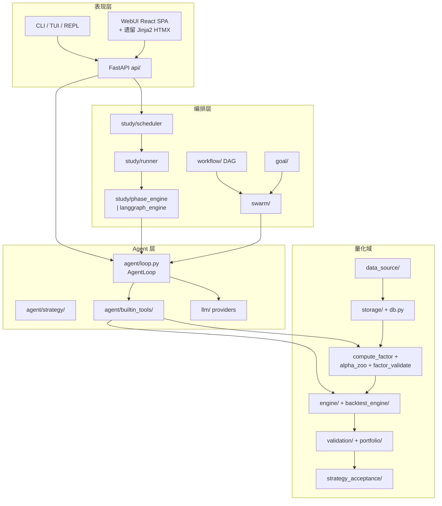

# 代码地图（code-map）

> 当前结构核对：2026-11-23，代码快照 `7f8eb230`；仅描述代码与装配，不代表全部功能已实机验收。
> 原 2026-09-21 快照保留在本文「历史快照」之后，不作为现行路径或能力依据。

## 当前结构：先从哪里看

| 问题 | 入口 |
|---|---|
| 四层归属与方向如何判定 | [layer_matrix.py](../../scripts/arch/layer_matrix.py)；设计依据为[四层骨架](../design/layered-skeleton-design-20261103.md) |
| 入口与运行参数 | [CLI 参数与分发](../../src/agentnodes/interfaces/cli/__init__.py)、[CLI 主入口](../../src/agentnodes/interfaces/cli/__main__.py)、[FastAPI 应用工厂](../../src/agentnodes/interfaces/api/app.py)、[MCP 服务](../../src/agentnodes/interfaces/mcp/server.py) |
| 会话发送到执行、流式返回 | [chat 路由](../../src/agentnodes/interfaces/api/routers/chat.py)、[聊天用例](../../src/agentnodes/apps/chat/send_turn.py)、[Gateway](../../src/agentnodes/kernel/gateway/gateway.py)、[SessionController](../../src/agentnodes/kernel/gateway/session_controller.py)、[SSE hook](../../webui/frontend/src/hooks/useSSE.ts) |
| 会话数据和消息历史 | [API 容器](../../src/agentnodes/interfaces/api/container.py)、[EventStore](../../src/agentnodes/kernel/session/state/event_store.py)、[Projector](../../src/agentnodes/kernel/session/projector.py)、[SessionStore](../../src/agentnodes/kernel/session/store.py) |
| 前端页面、启动与设计进度 | [前端路由](../../webui/frontend/src/App.tsx)、[前端 README](../../webui/frontend/README.md)、[U-A 执行计划及后续回填](../design/ui-ua-frontend-execution-plan-20261122.md) |
| 运行测试、门禁及扩展点 | [测试 lane](test-marker-lanes-design.md)、[脚本说明](../../scripts/README.md)、[扩展点](extension-points.md)、[项目规则](../../.rules/rules.md) |

### 1. 当前目录和职责

```text
src/agentnodes/
  interfaces/   L1  CLI/TUI、HTTP API、MCP；组合根和宿主接线
  apps/         L2  chat、goal、evolution 等产品策略和业务插件
  kernel/       L3  gateway、agent、session、运行时、workflow 等平台机制
  foundation/   L4  config、llm、storage、observability、utils、web
  evals/            旁挂评估带；分层门禁记账为 L3，不表示语义上属于 kernel
  templates/        随 Python 包分发的模板
  scripts/          包内维护脚本，非独立架构层
webui/
  frontend/         React/TypeScript/Vite 源码与前端测试
  static/           前端静态产物目录，默认构建输出会覆盖其中内容
tests/              Python 测试、fixture、视觉基线和端到端测试
scripts/            架构门禁、开发工具和迁移脚本；见 scripts/README.md
docs/               索引、指南、设计记录、架构图和历史归档
testcase/golden/    拆分移除的历史业务快照，不是当前生产代码
```

仓库根还包含 `examples/`、`dags/`、`strategies/` 和 `templates/` 等资源；运行时
数据库、缓存、临时构建目录及本地工作区不视为源码结构，也不应据此推断均由 Git 跟踪。
Python 包发现和包内模板打包规则见 [pyproject.toml](../../pyproject.toml)。

### 2. 四层模块地图

| 层 | 当前物理目录 | 主要职责和入口 |
|---|---|---|
| L1 | [interfaces](../../src/agentnodes/interfaces/) | `api/` 路由、认证及依赖容器；`cli/` 的 CLI/TUI/REPL；`mcp/`；`gateway_wiring.py`、`rsi_wiring.py` 等装配入口 |
| L2 | [apps](../../src/agentnodes/apps/) | `chat/` 发送用例与策略；`goal/` 长程目标；`evolution/` 进化领域策略与驱动；`agent_plugins/`、`algo/`、`scheduled_research/`、`swarm_presets/`；能力注册和工作区装配等平文件 |
| L3 | [kernel](../../src/agentnodes/kernel/) | `gateway/` 准入与会话控制；`orchestration/` 请求、队列及任务身份；`runtimes/` 通用图执行；`agent/` 循环、工具、策略与隔离；`session/` 会话与事件投影；`workflow/`、`swarm/`、`evolution/` 及上下文、权限、记忆、技能、hooks |
| L4 | [foundation](../../src/agentnodes/foundation/) | `config/` 配置和路径；`llm/` 客户端与供应商；`storage/` 持久化；`observability/` 日志；`utils/`、`web/` 与基础协议 |
| 旁挂 | [evals](../../src/agentnodes/evals/) | 评估集与执行器跨层读取被测对象；`layer_matrix.py` 将其登记为 L3 门禁记账位，而不是将其定义为 L3 业务包 |

依赖方向以层归属表的最长前缀匹配为准：L1 → L2 → L3 → L4，只允许向下或同层
依赖；`agentnodes.templates` 在门禁中登记为 L2。`kernel` 需要业务能力时通过
能力注册/解析等端口获取，具体实现和装配不应反向 import `apps`。
2026-11-23 运行 `python scripts\arch\check_dangling_imports.py --layers`：
六类上行违规均为 0，跨层 import 语句为 L1→L2 76、L1→L3 139、L1→L4 71、
L2→L3 49、L2→L4 14、L3→L4 93；每条 import 语句计数，不能解释为模块数量。

RSI 并非只存在于一个目录：[kernel/evolution](../../src/agentnodes/kernel/evolution/)
提供内核机制，[apps/evolution](../../src/agentnodes/apps/evolution/) 承载领域策略与驱动，
[interfaces/rsi_wiring.py](../../src/agentnodes/interfaces/rsi_wiring.py) 负责跨层装配。
包存在或装配代码存在，不证明 RSI 前端已有完整可用的数据接口。

### 3. 主调用与数据流

以下是**Web Chat 的主要路径**，不是所有 CLI/MCP/工作流请求都经过同一个 HTTP 路由：

1. [Composer](../../webui/frontend/src/components/chat/Composer.tsx) 向
   `/api/chat/send_async` 发请求；[API 客户端](../../webui/frontend/src/api/client.ts)
   负责公共请求及认证处理。
2. [chat 路由](../../src/agentnodes/interfaces/api/routers/chat.py) 检查会话归属，
   调用 [apps/chat/send_turn.py](../../src/agentnodes/apps/chat/send_turn.py)
   的历史预检，创建 attempt 并向 Gateway 提交；斜杠命令存在单独处理路径。
3. [Gateway](../../src/agentnodes/kernel/gateway/gateway.py) 与
   [EntryPoint](../../src/agentnodes/kernel/orchestration/entry_point.py) 负责请求准入及队列；
   [SessionController](../../src/agentnodes/kernel/gateway/session_controller.py) 驱动
   [GraphEngine](../../src/agentnodes/kernel/runtimes/graph_engine.py) 和相应节点/Agent。
4. [API 容器](../../src/agentnodes/interfaces/api/container.py) 装配共享的 SessionStore、
   EventStore、Projector、MemoryManager 和 SessionService。持久化事件以 `event_log`
   为事实源，Projector 提供消息读模型；部分临时事件只推送，不应笼统视作持久化。
5. `/api/chat/events` 从 EventStore 订阅，前端
   [useSSE](../../webui/frontend/src/hooks/useSSE.ts) 将事件分发到 stores；
   历史读通过会话服务/投影恢复。真实模型配置、权限和服务可用性仍决定实际运行结果。

L1 的 [gateway_wiring.py](../../src/agentnodes/interfaces/gateway_wiring.py) 负责
把跨层能力接入 Gateway；不要把“组件类存在”误写成“每次启动都已接线成功”。

### 4. Web 前端和接口边界

| 位置 | 作用 |
|---|---|
| [webui/frontend/src](../../webui/frontend/src/) | `App.tsx` 路由；`components/` 界面；`stores/` 状态；`api/` 客户端；`hooks/sse/` 事件分发；`styles/` 主题与令牌；`test/` 组件/状态测试 |
| [App.tsx](../../webui/frontend/src/App.tsx) | 登录、注册、Chat、监控、DAG、Study、Run、策略、因子和管理等路由；`/` 为监控页，登录成功进入 `/chat` |
| [app.py](../../src/agentnodes/interfaces/api/app.py) | 挂载 auth、chat、session、goal/workflow、permission、system、schedule 等路由；`/api/study` 和 `/api/run` 未在当前应用中挂载 |
| [FactorLibraryPage](../../webui/frontend/src/pages/FactorLibraryPage.tsx) | 因子页使用已标注的 mock 数据，页面存在不等于生产数据已接入 |
| [前端 README](../../webui/frontend/README.md) | 启动、登录、模型配置和构建说明；Vite 构建默认输出到 `webui/static`，验证前须确认是否会覆盖他人的产物 |

Trace、审批、会话和双主题等前端能力的实施和验收进展，以
[U-A 执行计划的执行记录](../design/ui-ua-frontend-execution-plan-20261122.md#12-执行记录模板)
为准；前文旧基线不是最新状态。不要把 mock、路由存在或测试结果写成所有功能真实联调完成。

### 5. 可复核的规模快照

2026-11-23 在 `7f8eb230`，按 `git ls-files` 统计对应目录内已跟踪的 `.py` 文件：
`interfaces` 121、`apps` 50、`kernel` 224、`foundation` 64、`evals` 6；
合计 465，其中架构图的 L3 230 包含 kernel 224 与旁挂 evals 6。
`tests/` 已跟踪 Python 文件 590；`webui/frontend/src/` 已跟踪 `.ts`/`.tsx` 文件 300。
这些是文件数，不是测试用例数，也不包括未跟踪文件；后续变更须重新测量。

复核方式（从仓库根运行，分别替换目录）：

```powershell
@(git ls-files -- 'src/agentnodes/kernel/*.py').Count
@(git ls-files -- 'tests/*.py').Count
@(git ls-files -- 'webui/frontend/src/*.ts' 'webui/frontend/src/*.tsx').Count
python scripts\arch\check_dangling_imports.py --layers
```

架构图和其他统计有自己的统计范围，见 [README 架构节](../../README.md#架构)、
[分层总图](../architecture-layered.html) 和 [L3 聚合图](../architecture-layered-l3-clusters.html)。
需要更新图中机器生成的统计时，先阅读项目规则及脚本，不手改数字冒充实测。

---

# 历史快照：2026-09-21（非当前结构）

> 以下保留原始 v0.6.0-dev 梳理，包含当时的工作区状态及已移除目录，仅用于追溯。
> 其中的路径、数量、技术债和“未提交工作”均不代表当前状态；请使用上面的当前结构。

---

## 1. 体量

| 项 | 数 |
|---|---|
| 源码 py | 914 |
| 测试 py | 560 |
| 文档 md | 138 |
| 最大文件 | `agent/loop.py` 109KB、`api/session/service.py` 94KB、`core/autoresearch.py` 77KB |
| 测试 : 源码 | ≈ 0.93 : 1（architecture-review 口径 6,071 tests） |

版本不一致：`pyproject.toml` = 0.6.0，`src/__init__.py` = 0.3.0，git tag 最新 v0.5.0。

---

## 2. 分层结构



---

## 3. 量化域（core 下数据→因子→回测）

**主数据流**

`data_source`（8 loader + fallback 链）→ `data_import` → `db.py`/DuckDB(OHLCV) → `compute_factor` DSL 或 `alpha_zoo` → `factor_validate`（IC/6 维/去重）→ `config_runner` 合成信号 → `engine`（bar-by-bar）或 `backtest_engine`（Strategy/Callback 双路径）→ `backtest.py` runs + metrics → `validation`（MC/Bootstrap/WF）→ `portfolio` → `strategy_acceptance.decide`。

| 模块 | 职责 | 关键入口 |
|---|---|---|
| `data_source/` | 多源行情，Protocol+Registry | `base.py:23 DataLoader`、`registry.py:77 FALLBACK_CHAINS` |
| `storage/` | DataStore Protocol → DuckDB 适配 | `data_store.py:32`、`duckdb_store.py:27` |
| `db.py` | DuckDB 单文件事实库 | `register_factor:774`、`get_factors:846` |
| `compute_factor.py` | ~80 算子表达式 DSL + 解析器 | `evaluate_expression:1253`、`analyze_complexity:968` |
| `factor_validate.py` | IC/IR、6 维评分、Mutual IC | `validate_factor:395` |
| `alpha_zoo/` | 5 库 ~470 因子（py+yaml 成对） | `loader.py:16 compute_alpha` |
| `engine/` | 多市场 bar-by-bar | `runner.py:276 run_engine_backtest` |
| `backtest_engine/` | 统一回测 Protocol | `protocol.py:37`、`factory.py:76` |
| `validation/` | MC / Bootstrap / Walk-forward | `runner.py:22 run_validation` |
| `strategy_acceptance/` | 硬阈值 + 可选 LLM 准入 | `decide()` |

**统一模式**：Protocol + Registry + Adapter（DataLoader / DataStore / BacktestEngine 三处同构）。

---

## 4. 编排与 Agent

**典型研究链**

`StudyScheduler` → `AutoresearchRunner._run_one_round` → `run_round_phases`（phase_engine 或 langgraph_engine）→ `spawn_agent` → `role_factory.run_agent_via_llm` → `AgentLoop` → builtin_tools → AEGIS 门禁 / claims 校准 → 评估 → 预算与 goal 判定。

| 模块 | 职责 | 备注 |
|---|---|---|
| `agent/loop.py` | ReAct 主循环 + hooks + 沙箱 | 2400+ 行，全库中枢 |
| `agent/strategy/` | LoopStrategy = 9 个 Step 组合 | Minimal / Explorer / Validator 变体 |
| `study/` | 长程多轮研究 | 双引擎：phase vs langgraph；`engine='dag'` 静默映射到 langgraph |
| `workflow/` | 可审批 DAG | 与 goal/workflow 并行两套 |
| `swarm/` | DAG 分层并行多 agent | presets/ 35 套 YAML |
| `goal/` | 目标工作流 | 已委托 SwarmRuntime |
| `hypothesis/` | 假设注册（JSON） | loop 自动建假设 |
| `llm/` | OpenAI 兼容客户端 | provider/ 适配器 + fallback |
| `mcp/` | 只读研究工具 MCP | 复用 agent tool registry |

**双重实现（收敛建议点）**
1. phase_engine ↔ langgraph_engine（dag 假选项）
2. chat_loop ↔ role_factory 两套 AgentLoop 构造
3. goal/workflow ↔ workflow/executor 两套 DAG
4. sandbox/legacy.py 能力实际仍在 legacy，StaticSandbox 未接管
5. chat.py ↔ web_session.py SessionService/EventBus 接线重叠

---

## 5. 表现层

**API**：`api/app.py:22 create_app`，约 22 个 router 全挂 `/api/*`。事件溯源现行链：`core.agent.event_store` → `bridge_v2` → `sse_buffer`（Last-Event-ID 回放）→ `projector` 物化 messages。`events.py` / `event_bus_v2.py` 已标 deprecated。

**CLI** 调度矩阵（`cli/__main__.py`）：
- TTY 裸调用 → Textual TUI
- `--repl` / `--banner` → prompt_toolkit REPL
- 子命令 / 非 TTY → argparse（~19 子命令）

**WebUI 双前端**：
- 主：`webui/frontend/` React 19 + Vite + TS + Tailwind + zustand + SSE hooks
- 遗留：`src/agentnodes/webui/routes.py` Jinja2 + HTMX（prefix `/webui`）

**tests**：537 个扁平 `test_*.py` + `attic/` 12 退役 + `_fixtures/` 8 共享。CI：3.10–3.12 矩阵 + ruff + Playwright e2e。

---

## 6. 技术债与仓库卫生

| 优先级 | 项 | 位置 |
|---|---|---|
| ~~P0 Bug~~ | ~~`registry.keys()` 返回 `(k,v)` 元组~~ **已修** | `core/registry.py` |
| P0 | 版本号三处不一致（pyproject 0.6.0 / `__init__` 0.3.0 / tag v0.5.0） | |
| P1 | 根 `templates/` 是漂移副本（缺 `.prompts/`，若干文件哈希不同），代码只用 `src/.../templates/` | 建议删除或同步 |
| P1 | 三套 backtest 模型并存 | `core/backtest_models.py`、`utils/backtest_models.py`、`engine/models.py` |
| P1 | `agent/loop.py` / `api/session/service.py` / `core/autoresearch.py` 巨型文件待拆 | |
| P2 | alpha_zoo 新旧 loader 并行（`loader.py` vs `alpha_zoo_adapter/convert/yaml`） | |
| P2 | 前端 Study API 死端点 16 个 | 根 `UNUSED` 清单 |
| P2 | 双前端 + 双事件桥（events / event_bus_v2 标 deprecated 仍在） | |
| P3 | 根目录 `analysis/`、未跟踪 PDF、`install.py/sh` 归属 | `analysis/` 未 ignore |
| P3 | `study/_archived/`（Temporal 五件套等）已隔离，可择期删 | |

---

## 7. 未提交工作（当前工作区）

「因子入库纪律 / 复杂度约束门」（QuantaAlpha 风格）：
1. `compute_factor.analyze_complexity` — 算子数 / 自由参数 / 特征数加权分
2. `db.register_factor` — 自动复杂度分析，解析失败 fail-closed；factor_registry 增 6 列（复杂度 4 + `info_channel` + `parent_hypothesis_id`），旧库 `_ensure_factor_registry_columns` 迁移
3. `factor_validate.compute_mutual_ic` — 由首日截面改为逐日 Spearman 均值
4. tests：`test_factor_registry_discipline.py`（新）+ `test_factor_validate.py` 扩充；prompts 同步

涉及文件 8 个（+322/−24），另未跟踪 `UNUSED`、`analysis/`、docs PDF 2 份。

---

## 8. 一页速查

```
agentnodes/
├── core/          量化域 + Agent + 编排（主战场）
│   ├── data_source/ storage/ engine/ backtest_engine/
│   ├── alpha_zoo/ compute_factor factor_validate db backtest
│   ├── agent/     loop, strategy, builtin_tools, sandbox
│   ├── study/     scheduler, runner, phase|langgraph, aegis
│   ├── workflow/ swarm/ goal/ hypothesis/
│   └── llm/ memory/ hooks/ validation/ portfolio/
├── api/           FastAPI + session 事件溯源 + SSE
├── cli/           TUI / REPL / argparse
├── templates/     真源（打包）
└── webui/         routes.py（遗留 HTMX）
webui/frontend/    React SPA（主前端）
tests/             537 + attic + _fixtures
```
